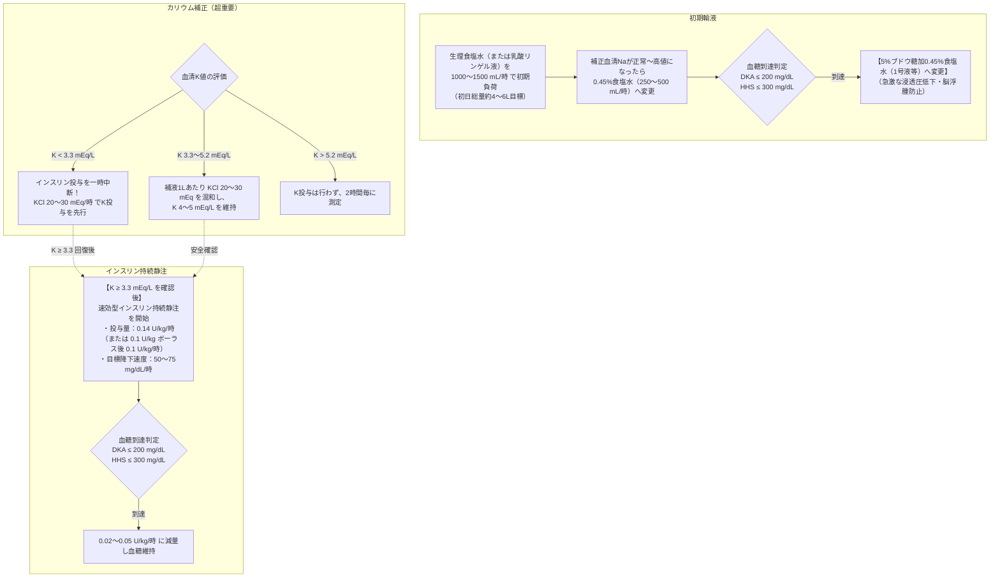

# 高血糖緊急症 (DKA, HHS)
親カテゴリ: [[clinical-flows/G_代謝・内分泌/index|G章 代謝・内分泌]]

## DKA と HHS の診断基準と対比

| 評価項目 | 糖尿病性ケトアシドーシス (DKA) | 高血糖高浸透圧症候群 (HHS) |
| :--- | :--- | :--- |
| **主病態** | インスリンの絶対的欠乏 ＋ ケトン体蓄積[cite: 541] | 相対的インスリン欠乏 ＋ 極度の脱水・高浸透圧[cite: 541] |
| **好発** | 主に1型糖尿病（2型も10〜30%あり）、若年〜成人[cite: 541] | 主に2型糖尿病、高齢者、感染症・脱水が契機[cite: 541, 542] |
| **血糖値** | $>250\ \mathrm{mg/dL}$[cite: 541] | **$>600\ \mathrm{mg/dL}$**（しばしば $>1000$）[cite: 541] |
| **動脈血 pH** | **$\le7.30$**（重症は $<7.00$）[cite: 541] | $>7.30$（正常〜軽度低下）[cite: 541] |
| **血清 $\mathrm{HCO_3^-}$**| **$\le18\ \mathrm{mEq/L}$**（重症は $<10$）[cite: 541] | $>18\ \mathrm{mEq/L}$[cite: 541] |
| **血中/尿中ケトン** | **強陽性**（$\beta$-ヒドロキシ酪酸著増）[cite: 541] | 陰性〜弱陽性[cite: 541] |
| **有効血漿浸透圧** | 変動あり[cite: 541] | **$>320\ \mathrm{mOsm/kg}$**[cite: 541] |
| **アニオンギャップ** | **$>10〜12\ \mathrm{mEq/L}$（開大）**[cite: 541] | 変動あり（通常正常範囲）[cite: 541] |

---

## 治療プロトコル（輸液・インスリン・電解質）

> [!WARNING]- 炭酸水素ナトリウム（重曹）投与の原則非推奨
> 重症アシドーシスであっても、$\mathrm{pH} \ge6.90$ では重曹投与は予後を改善せず、低K血症の悪化、脳浮腫リスク、組織低酸素（オキシヘモグロビン解離曲線左方移動）を招くため投与しない[cite: 544, 545]。$\mathrm{pH} < 6.90$ の極度の酸血症に限り、重曹 100 mmol ＋ KCl 20 mEq を2時間かけて点滴することを考慮する[cite: 544, 545]。

> [!NOTE]- 寛解判定基準（皮下注射インスリンへの切り替え）
> 血糖 $<200\ \mathrm{mg/dL}$ に加え、以下のうち2つ以上を満たした場合にDKA寛解と判定する[cite: 542, 544]：
> 1. 血清 $\mathrm{HCO_3^-} \ge15\ \mathrm{mEq/L}$[cite: 542, 544]
> 2. 静脈血 $\mathrm{pH} > 7.30$[cite: 542, 544]
> 3. アニオンギャップ $\le12\ \mathrm{mEq/L}$[cite: 542, 544]
> ※持続静注を中止する**1〜2時間前に皮下インスリン（持効型等）を先行注射**し、リバウンド高血糖を防止する[cite: 544]。
