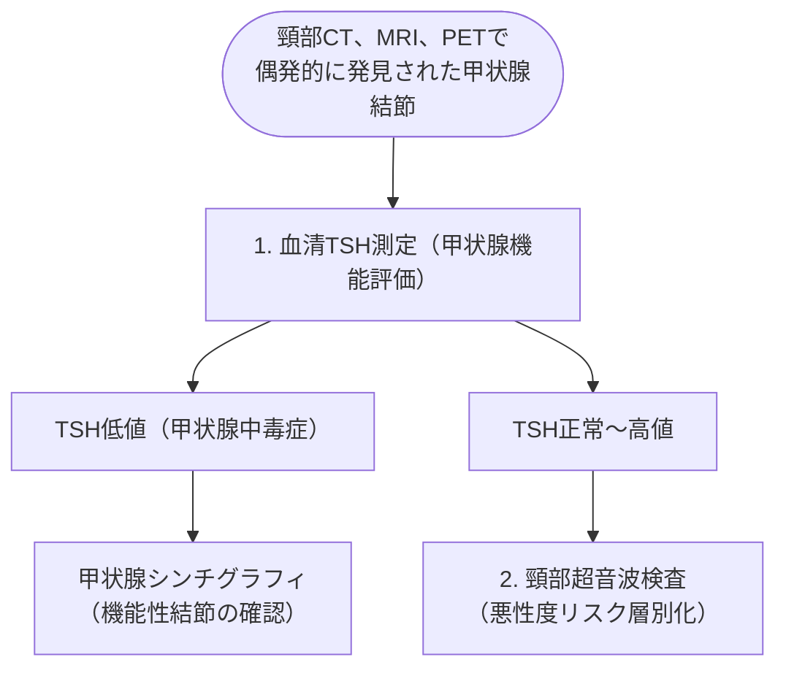

# 甲状腺偶発腫瘍の評価
親カテゴリ: [[clinical-flows/G_代謝・内分泌/index|G章 代謝・内分泌]]

## 初期評価フロー

---

## 超音波所見と穿刺吸引細胞診 (FNA) の適応（ATA 2015 基準）

| リスク分類 | 超音波所見の特徴 | 悪性率 | FNA適応サイズ |
| :--- | :--- | :--- | :--- |
| **高リスク** | 充実性低エコー結節 ＋ 以下のいずれか：微小石灰化、不整な辺縁、縦横比 $>1$（taller-than-wide）、被膜外浸潤[cite: 553] | 70〜90%[cite: 553] | **$\ge1.0\ \mathrm{cm}$**[cite: 553] |
| **中リスク** | 充実性低エコー結節（高リスク所見なし）[cite: 553] | 10〜20%[cite: 553] | **$\ge1.0\ \mathrm{cm}$**[cite: 553] |
| **低リスク** | 等エコー〜高エコー充実性結節、または嚢胞充実性結節[cite: 553] | 5〜10%[cite: 553] | **$\ge1.5\ \mathrm{cm}$**[cite: 553] |
| **極低リスク**| 海綿状（スポンジ様）結節、部分性嚢胞性結節[cite: 553] | <3%[cite: 553] | **$\ge2.0\ \mathrm{cm}$**（または経過観察）[cite: 553] |
| **良性** | 純嚢胞性結節[cite: 553] | <1%[cite: 553] | **FNA不要**（経過観察）[cite: 553] |

> [!WARNING]- 1 cm 未満の結節に対する過剰診断・治療の抑制
> 超音波で悪性を疑う高リスク所見があっても、**径 $<1.0\ \mathrm{cm}$ の微小結節に対しては原則としてFNAを行わず経過観察**とする[cite: 552]。ただし、明らかな頸部リンパ節転移、甲状腺外浸潤、小児期放射線被曝歴、甲状腺癌家族歴がある場合は $1.0\ \mathrm{cm}$ 未満でもFNAを考慮する[cite: 552]。

> [!NOTE]- PET/CT 偶発病変 (Thyroid Incidentaloma)
> ${}^{18}\mathrm{F}$-FDG-PETで甲状腺に局所集積（focal uptake）が認められた場合、**約30〜35%が悪性腫瘍**であるため、サイズに関わらず超音波検査を行い積極的にFNAを検討する[cite: 551, 552]。びまん性集積は慢性甲状腺炎（橋本病）を示唆する。
