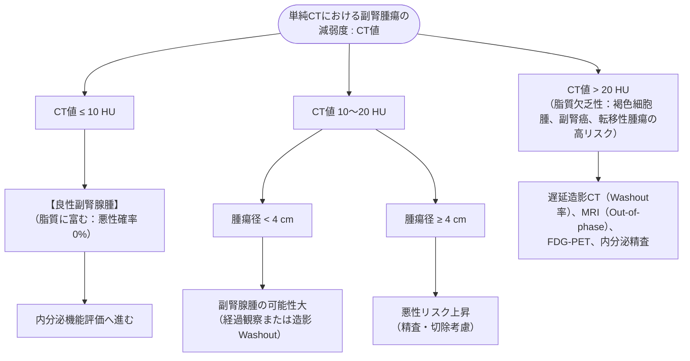

# 副腎偶発腫瘍の評価
親カテゴリ: [[clinical-flows/G_代謝・内分泌/index|G章 代謝・内分泌]]

## 評価の2大命題
画像検査で偶発的に発見された副腎腫瘤（$>1\ \mathrm{cm}$）に対し、**①「悪性腫瘍（副腎癌・転移）か良性か」**、**②「ホルモン過剰産生があるか」** を同時に判定する[cite: 556]。

---

## 形態学的評価（単純CT値）

> [!WARNING]- 褐色細胞腫除外前の生検・造影CTの禁止
> 褐色細胞腫を疑う病変に対して、不用意に造影剤投与、β遮断薬単独投与、穿刺生検（FNA）を行うと、致死的なカテコラミンクリーゼ（悪性高血圧、不整脈、ショック）を誘発する[cite: 558]。**FNAを行う前には必ずカテコラミン過剰を除外**すること[cite: 558]。

---

## 内分泌機能スクリーニング（全例必須）

1. **コルチゾール自律分泌（MACS / サブクリニカルクッシング症候群）**:
   - **1 mg デキサメタゾン抑制試験 (DST)**: 前日23時にデキサメタゾン 1 mg内服 → 翌朝8時コルチゾール測定[cite: 558, 560]。
   - **判定**: コルチゾール **$\ge1.8\ \mu\mathrm{g/dL}$** で自律分泌あり（MACS）と判定[cite: 560, 561]。
2. **原発性アルドステロン症 (PA)**:
   - 高血圧または低K血症を伴う場合、**アルドステロン/レニン比 (ARR)** を測定[cite: 558, 559, 562]。
3. **褐色細胞腫**:
   - 単純CT値 $>10\ \mathrm{HU}$ の全例で、**血漿遊離メタネフリン分画** または **24時間蓄尿メタネフリン・ノルメタネフリン** を測定[cite: 558, 559]。
