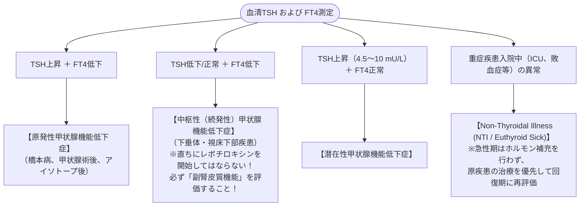

# 甲状腺機能低下症
親カテゴリ: [[clinical-flows/G_代謝・内分泌/index|G章 代謝・内分泌]]

## 診断アルゴリズム

---

## 治療プロトコル（レボチロキシン：チラーヂンS）

- **若年成人・健常者**: **1.6 µg/kg/日**（約50〜100 µg/日）から開始[cite: 567]。
- **高齢者（$\ge60$ 歳）または 虚血性心疾患合併例**:
  - 急激な補充は狭心症・不整脈を誘発するため、**12.5〜25 µg/日 の少量から開始**し、4〜8週間ごとに漸増[cite: 567]。
- **服薬指導**: 胃酸分泌に依存して小腸から吸収されるため、**起床時空腹時（朝食前30〜60分）または就寝前**にコップ1杯の水で服薬[cite: 566]。鉄剤、Ca製剤、PPIとの同時服用は避ける[cite: 567, 569]。

---

## 潜在性甲状腺機能低下症の治療適応

- **TSH $\ge10.0\ \mathrm{mU/L}$**: 心血管イベント・死亡率上昇と関連するため、症状に関わらずレボチロキシン治療を推奨[cite: 567]。
- **TSH 4.5〜9.9 mU/L**:
  - 65歳以上の高齢者：ホルモン治療による自覚症状・心機能改善は認められず（TRUST試験）、原則経過観察[cite: 567]。
  - 妊娠中、不妊治療中、有症状、抗TPO抗体強陽性例では治療を考慮[cite: 565, 567, 568]。

> [!WARNING]- 粘液水腫性昏睡 (Myxedema Coma)
> 重症甲状腺機能低下症患者が感染、寒冷曝露、外科手術を契機に発症する致死的多臓器不全（低体温、意識障害、徐脈、低血圧、低Na血症、低換気）[cite: 569, 570]。
> - **緊急治療**:
>   1. **ヒドロコルチゾン（ソル・コーテフ 100 mg 静注）を必ず先行投与**（相対的副腎不全による急性副腎クリーゼ死を防止）[cite: 570]。
>   2. レボチロキシン静注（チラーヂンS注 200〜400 µg 静注、以後 50〜100 µg/日）[cite: 570]。
>   3. 保温、人工呼吸器管理、低張輸液回避[cite: 570]。
