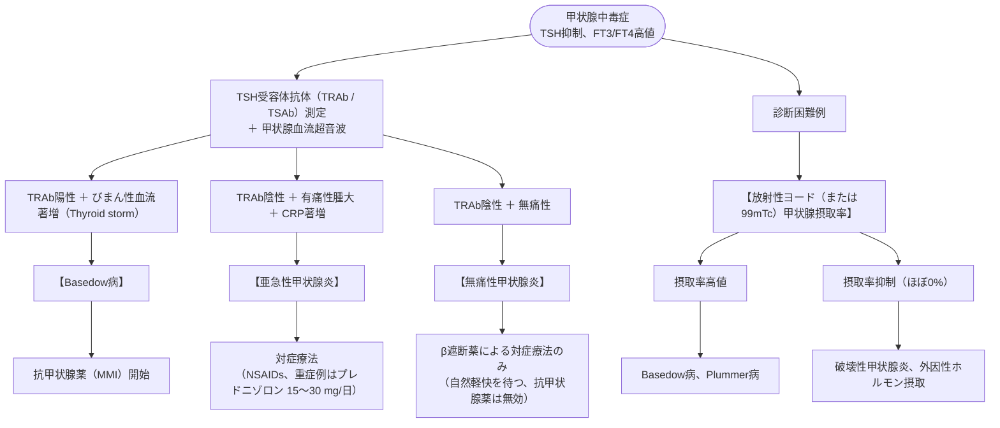

# 甲状腺機能亢進症／甲状腺中毒症
親カテゴリ: [[clinical-flows/G_代謝・内分泌/index|G章 代謝・内分泌]]

## 鑑別診断：Basedow病 vs 破壊性甲状腺炎

甲状腺ホルモン過剰（TSH低下、FT4/FT3上昇）を認めたら、**「甲状腺機能亢進（ホルモン過剰産生）」** か **「破壊性甲状腺炎（ホルモン漏出）」** かを鑑別する[cite: 571, 574]。

---

## Basedow病の薬物治療と副作用管理

- **第一選択薬**: **チアマゾール（メルカゾール：MMI 15〜30 mg/日）**[cite: 575]。
- **プロピルチオウラシル（チウラジール：PTU 300 mg/日）の適応**: 妊娠初期（器官形成期：MMIの頭皮欠損等催奇形性回避）、MMI不耐例、甲状腺クリーゼ[cite: 575, 578, 580]。

> [!WARNING]- 抗甲状腺薬の3大重篤副作用
> 1. **無顆粒球症 (0.1〜0.5%)**: 服用開始後3か月以内に好発[cite: 575]。発熱・咽頭痛出現時は直ちに服薬を中止させ、緊急で白血球・分画を測定する（好中球 $<500\ /\mu\mathrm{L}$ で入院・G-CSF・広域抗菌薬）[cite: 575]。
> 2. **重篤な肝障害**: PTUによる劇症肝炎、MMIによる胆汁うっ滞性黄疸[cite: 575]。
> 3. **ANCA関連血管炎**: PTU長期連用時にMPO-ANCA陽性血管炎（腎炎、肺出血）を惹起[cite: 575]。

---

## 甲状腺クリーゼ (Thyroid Storm) の緊急治療

未治療またはコントロール不良のBasedow病に、感染・外傷・手術・分娩等が加わって生じる致死病態（死亡率10〜20%）[cite: 577, 578]。

- **臨床5徴**: 高熱（$\ge38^\circ\mathrm{C}$）、頻脈（$\ge130$ 回/分）、中枢神経症状（せん妄、不穏、昏睡）、うっ血性心不全、消化器症状（黄疸、下痢）[cite: 578]。
- **多剤併用プロトコル**[cite: 577, 578]：
  1. **抗甲状腺薬**: PTU 200 mg 4時間毎（または MMI 20 mg 6時間毎）[cite: 578]。
  2. **無機ヨード（抗甲状腺薬投与の1時間後以降に投与！）**:
     - 飽和ヨウ化カリウム溶液 (SSKI) または ヨウ化カリウム 50 mg 6時間毎（Wolff-Chaikoff効果によるホルモン放出阻止）[cite: 578]。
  3. **副腎皮質ステロイド**: ヒドロコルチゾン 100 mg 8時間毎静注（末梢でのT4→T3変換抑制と副腎予備能低下対策）[cite: 578]。
  4. **β遮断薬**: ランジオロール（オノアクト）持続静注 または プロプラノロール経口[cite: 578]。
