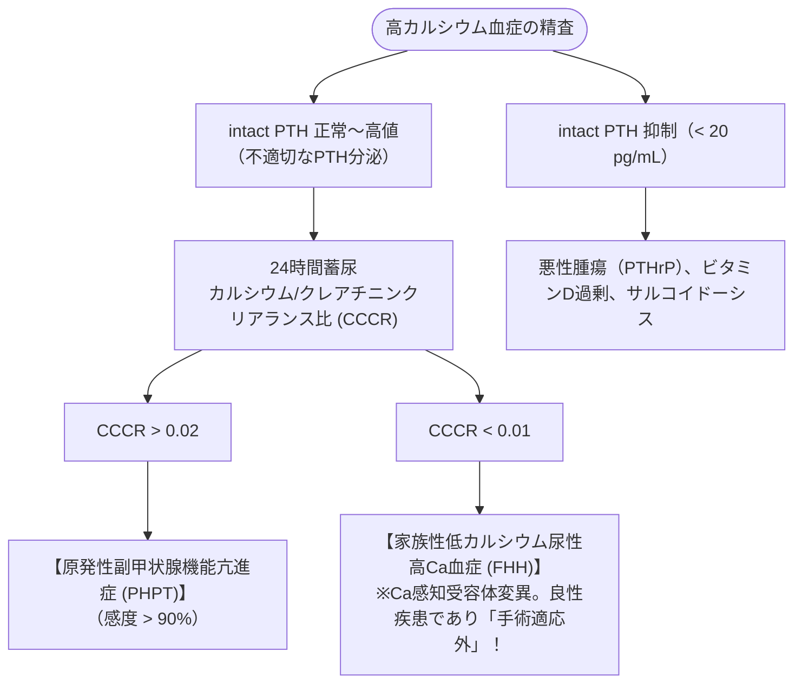

# 原発性副甲状腺機能亢進症
親カテゴリ: [[clinical-flows/G_代謝・内分泌/index|G章 代謝・内分泌]]

## 診断アルゴリズム

---

## 手術適応基準（無症候性PHPTガイドライン）

症候性（骨折、尿路結石、高Caクリーゼ）は全例手術適応[cite: 581, 583]。無症候性であっても、以下の**いずれか1つを満たせば副甲状腺摘出術 (PTx) を推奨**する[cite: 584]：

1. **血清カルシウム値**: 施設基準値上限より **$>1.0\ \mathrm{mg/dL}$** の上昇[cite: 584]。
2. **骨密度低下**: 腰椎、大腿骨頸部、または前腕骨のいずれかで **Tスコア $\le-2.5$**、または脆弱性骨折の存在[cite: 584]。
3. **腎機能低下**: **eGFR $<60\ \mathrm{mL/min/1.73m^2}$**[cite: 584]。
4. **腎結石・腎石灰化**: 画像上の無症候性結石、または24時間尿中Ca排泄量 $>400\ \mathrm{mg/day}$[cite: 584]。
5. **年齢**: **$<50$ 歳**[cite: 584]。

---

## 手術不能例・非適応例の薬物管理

- **シナカルセト（レグパラ 25〜50 mg/日）**:
  - カルシウム受容体作動薬（カルシミメティクス）[cite: 585]。副甲状腺細胞のCaSRを刺激し、血清Ca値を速やかに正常化させる[cite: 585]。骨密度改善効果は乏しい[cite: 585]。
- **ビスホスホネート（アレンドロン酸等）/ デノスマブ**:
  - 骨吸収を抑制し、骨密度の維持・改善を図る[cite: 585]。
- **水分管理**: 脱水は高Ca血症を増悪させるため、適切な飲水励行を指導する[cite: 584]。
