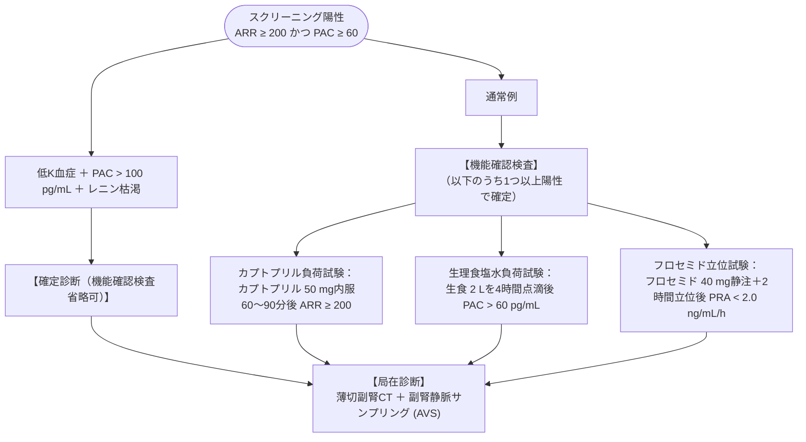

# 原発性アルドステロン症
親カテゴリ: [[clinical-flows/G_代謝・内分泌/index|G章 代謝・内分泌]]

## スクリーニング適応と判定（日本内分泌学会 2021基準）

二次性高血圧の最多原因（全高血圧の5〜10%）[cite: 586]。心肥大、心房細動、脳卒中、慢性腎臓病の発症リスクが本態性高血圧に比して顕著に高い[cite: 586]。

### スクリーニング判定条件
早朝安静坐位採血（CLEIA法によるPAC測定）[cite: 587, 589]：
- **判定基準**: **$\mathrm{ARR} \ge200$** かつ **$\mathrm{PAC} \ge60\ \mathrm{pg/mL}$**[cite: 587, 589]
  $$\mathrm{ARR} = \frac{\text{血漿アルドステロン濃度 (PAC: pg/mL)}}{\text{血漿レニン活性 (PRA: ng/mL/h)}}$$[cite: 587]
  ※活性型レニン濃度 (ARC: pg/mL) 測定時は **$\mathrm{PAC/ARC} \ge40$**[cite: 587, 589]。
- ※**低カリウム血症を伴うのは約20〜30%にすぎない**（正常Kでも積極的に疑う）[cite: 589]。

---

## 診断確定試験と局在診断

> [!WARNING]- 副腎静脈サンプリング (AVS) の必須性
> CT画像のみで腺腫と判断すると、対側過形成の見逃しや非機能性偶発腫瘍の誤認により、**約30〜40%で誤った切除術が行われる**[cite: 590]。外科的手術を希望する症例では、必ず専門施設へ紹介し**AVSによる左右局在判定**を行う[cite: 590]。

---

## 治療の選択

- **片側性（アルドステロン産生腺腫 APA）**: **腹腔鏡下副腎摘出術**（根治可能、術後血圧正常化・改善）[cite: 590, 591]。
- **両側性（特発性アルドステロン症 IHA）または 手術非希望例**:
  - **ミネラルコルチコイド受容体拮抗薬 (MRA)**:
    - **エサキセレノン（ミネブロ 2.5〜5.0 mg/日）**: 選択的非ステロイド型MRA。
    - **スピロノラクトン（アルダクトンA 25〜100 mg/日）**: 女性化乳房・月経不順に注意[cite: 591]。
    - **エプレレノン（セララ 50〜100 mg/日）**: 性ホルモン系副作用なし[cite: 591]。
