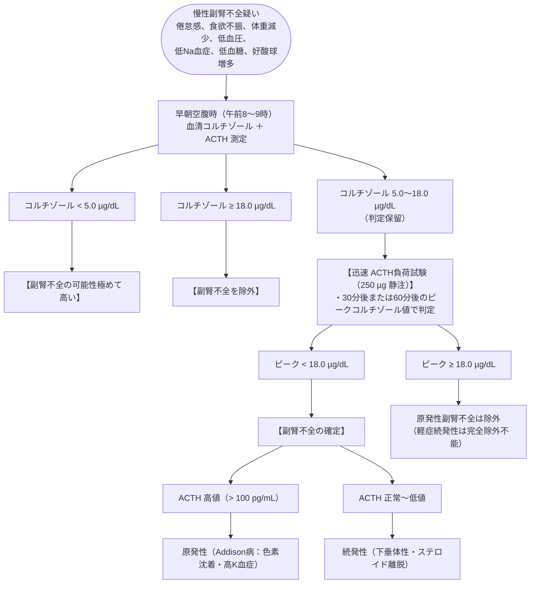

# 副腎不全
親カテゴリ: [[clinical-flows/G_代謝・内分泌/index|G章 代謝・内分泌]]

## スクリーニングと診断フロー

---

## 治療プロトコル（維持療法）

- **グルココルチコイド補充**:
  - **ヒドロコルチゾン（コートリル） 10〜20 mg/日**（体表面積あたり 6〜8 $\mathrm{mg/m^2/day}$）[cite: 596, 597, 598]。
  - 生理的分泌パターンに合わせ、**朝多め・夕方少なめの分割投与**（例：朝10 mg、昼〜夕方5 mg）[cite: 597, 598]。
- **ミネラルコルチコイド補充（原発性 Addison病のみ）**:
  - **フルドロコルチゾン（フロリネフ 0.05〜0.1 mg/日）**[cite: 598]。
  - ※続発性（下垂体性）ではアルドステロン分泌が保持されるため原則不要[cite: 597]。

---

## 急性副腎不全（副腎クリーゼ）の緊急治療

> [!WARNING]- ショック・原因不明の虚脱に対する即時投与
> 感染、外傷、手術等の侵襲下で急激な血圧低下、高熱、腹痛・嘔吐、低Na・高K・低血糖を呈する[cite: 598, 599]。血液培養と同時にコルチゾール採血を行い、**検査結果を待たずに直ちに治療を開始**する[cite: 598]。

1. **ヒドロコルチゾン（ソル・コーテフ） 100 mg を直ちに急速静注**[cite: 598]。
2. 以後、100 mg を6〜8時間毎に点滴投与（または 200 mg/24時間持続静注）[cite: 598]。
3. **大量輸液**: 生理食塩水（または5%ブドウ糖加生理食塩水）を急速投与（脱水と低Na・低血糖の同時補正）[cite: 598]。
4. 病勢安定後、数日かけて通常の経口維持量へ漸減[cite: 598]。

> [!NOTE]- 患者教育とシックデイルール
> 発熱（$>38^\circ\mathrm{C}$）や中等度ストレス時は、**経口コートリルを普段の2〜3倍量に増量内服**させる[cite: 599]。下痢・嘔吐で内服不能な場合は直ちに救急受診させ注射投与を行う[cite: 599]。
