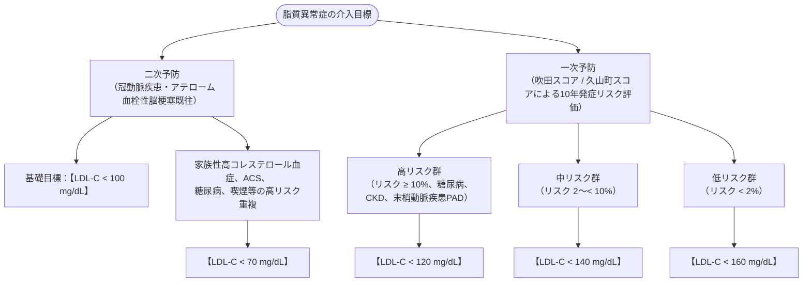

# 脂質異常症
親カテゴリ: [[clinical-flows/G_代謝・内分泌/index|G章 代謝・内分泌]]

## 動脈硬化リスク分類とLDL-C目標値（動脈硬化予防ガイドライン 2022）

---

## 薬物治療戦略

### 1. 高LDL-C血症に対するスタチンと併用薬
- **第一選択**: **スタチン（HMG-CoA還元酵素阻害薬）**[cite: 607, 610]。
  - 高強度スタチン: アトルバスタチン 20 mg/日、ロスバスタチン 10〜20 mg/日（国内承認量内）[cite: 611]。
- **上乗せ併用薬**:
  - **エゼチミブ（ゼチーア 10 mg/日）**: 小腸NPC1L1阻害薬。スタチン併用で心血管イベントを有意に抑制（IMPROVE-IT試験）[cite: 611, 615]。
  - **PCSK9阻害薬（エボロクマブ、アリロクマブ）**: 皮下注製剤。スタチン最大耐量でも目標未達の高リスク例・家族性高コレステロール血症に適応（LDL-C 50〜60%低下）[cite: 612, 616]。

### 2. 高トリグリセリド (TG) 血症の管理
- **$\mathrm{TG} \ge500\ \mathrm{mg/dL}$**: 急性膵炎発症防止のため、直ちにフィブラート系薬等で介入[cite: 449, 612]。
- **$\mathrm{TG}\ 150\sim499\ \mathrm{mg/dL}$**: まずLDL-Cを管理し、残余リスクに対して**高純度EPA製剤（イコサペント酸エチル 2〜4 g/日）** を検討（REDUCE-IT試験：心血管死を有意に抑制）[cite: 612, 615]。

---

## スタチン関連筋症状 (SAMS) の管理

> [!NOTE]- スタチン筋障害への対応フロー
> - 筋肉痛・筋力低下が出現した際は、直ちに血清CKを測定[cite: 613, 614]：
>   - **CK $\ge10 \times \mathrm{ULN}$ または 耐えられない激痛**: スタチンを直ちに中止[cite: 613, 614]。
>   - 中止後に症状・CKが正常化したら、少量投与、他系統スタチンへの変更（フルバスタチン等水溶性）、隔日投与を試みる[cite: 613, 614]。
>   - **中止後もCK高値・筋力低下が持続**: 抗HMGCR抗体測定を行い、**スタチン誘発性自己免疫性筋症 (IMNM)** を鑑別（免疫抑制療法が必要）[cite: 614]。
