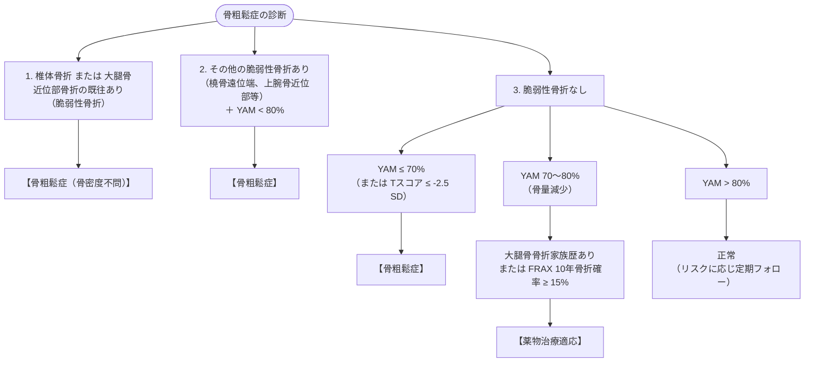

# 骨粗鬆症
親カテゴリ: [[clinical-flows/G_代謝・内分泌/index|G章 代謝・内分泌]]

## 診断基準（日本骨粗鬆症学会）

DXA法（腰椎 L2〜L4 または 大腿骨近位部）による若年成人平均値比（YAM: Young Adult Mean）で評価[cite: 617, 618]：

---

## 治療薬の選択基準とエビデンス

- **第一選択（骨吸収抑制薬）**:
  - **経口ビスホスホネート**（アレンドロン酸 35 mg/週、リセドロン酸 17.5 mg/週、ミノドロン酸 50 mg/4週）[cite: 619, 620]。
  - **静注ビスホスホネート**（ゾレドロン酸 5 mg 年1回点滴）：アドヒアランス確保[cite: 620, 621]。
  - **抗RANKL抗体（デノスマブ / プラリア 60 mg 6か月毎皮下注）**: 腎機能低下例でも使用可能。強力な骨密度上昇効果[cite: 619, 620]。
- **重症骨粗鬆症・多発骨折高リスク例（骨形成促進薬）**:
  - **PTH製剤（テリパラチド 20 µg/日 または 56.5 µg/週、最長24か月）**[cite: 619, 620]。
  - **抗スクレロスチン抗体（ロモソズマブ / イベニティ 210 mg/月皮下注、最長12か月）**: 骨形成促進と骨吸収抑制のデュアルアクション[cite: 619, 620]。

---

## 長期管理における重大な注意点

> [!WARNING]- デノスマブ中止後のリバウンド骨折
> デノスマブを休薬・中断すると、破骨細胞機能の急激なリバウンドにより骨代謝回転が急上昇し、**中止数か月〜1年以内に多発椎体骨折**を招く[cite: 621, 622, 623]。
> **デノスマブを中止する際は、必ず最終投与6か月後の時点でビスホスホネート（経口またはゾレドロン酸静注）へリレー投与**すること[cite: 623]。PTH製剤やロモソズマブ終了後も同様にビスホスホネートへの切り替えが必須[cite: 623]。

> [!WARNING]- 顎骨壊死 (ARONJ) と非典型大腿骨骨折 (AFF)
> - **骨吸収薬関連顎骨壊死 (ARONJ)**: 抜歯等の侵襲的歯科処置が契機となる[cite: 622]。治療開始前に歯科検診と口腔内清掃を完了させ、服薬中は良好な口腔衛生を維持[cite: 622]。
> - **非典型大腿骨骨折 (AFF)**: ビスホスホネート長期連用（$>3〜5$年）に伴う骨幹部横骨折[cite: 621, 622]。大腿外側の前駆痛出現時は単純X線で皮質肥厚を確認し、骨折リスク低下例では **Drug Holiday（休薬期間 1〜2年）** を考慮する[cite: 621]。
