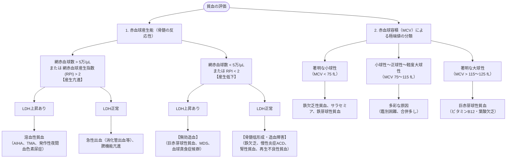

# 貧血のアセスメント
親カテゴリ: [[clinical-flows/H_血液/index|H章 血液]]

## 鑑別の3軸アプローチ

貧血（男性 Hb $<13\ \mathrm{g/dL}$、女性 Hb $<12\ \mathrm{g/dL}$）は、**①骨髄の赤血球産生能（網赤血球・RPI）**、**②赤血球破壊・無効造血（LDH・間接ビリルビン）**、**③赤血球サイズ（MCV）** の3軸で整理する[cite: 627, 628]。

---

## 網赤血球産生指数 (RPI: Reticulocyte Production Index)

貧血時の見かけ上の網赤血球パーセントを補正する指標[cite: 628]：
$$\text{RPI} = \frac{\text{網赤血球数 (\%)} \times (\text{実測Ht} / 45)}{\text{網赤血球成熟日数}}$$
※網赤血球成熟日数（Ht 45%で1.0日、Ht 35%で1.5日、Ht 25%で2.0日、Ht 15%で2.5日）[cite: 628]。
- **RPI $>2.0$**: 骨髄の造血反応良好（溶血または急性出血）[cite: 628]。
- **RPI $<2.0$**: 骨髄の造血反応不全（低産生または無効造血）[cite: 628]。

---

## 高齢者貧血の3大原因

> [!NOTE]- 高齢者（$\ge65$ 歳）の貧血の内訳
> 高齢者貧血の約1/3は栄養障害（鉄欠乏、ビタミンB12欠乏、葉酸欠乏）、約1/3は慢性炎症に伴う貧血 (ACD) および腎性貧血、残りの1/3が骨髄疾患（MDS、多発性骨髄腫）や原因不明である[cite: 627, 628]。
