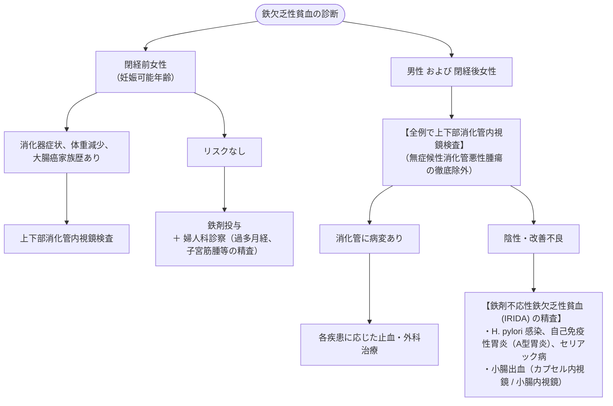

# 鉄欠乏性貧血
親カテゴリ: [[clinical-flows/H_血液/index|H章 血液]]

## 診断基準と生化学的指標

- **フェリチン（貯蔵鉄のゴールドスタンダード）**:
  - **$<15\sim20\ \mathrm{ng/mL}$**: 鉄欠乏性貧血を確定（LR+ 51.8）[cite: 630, 631]。
  - **$>100\ \mathrm{ng/mL}$**: 鉄欠乏を完全に除外[cite: 631]。
  - **$30\sim100\ \mathrm{ng/mL}$**: 慢性炎症（ACD）の合併を考慮（炎症下ではフェリチンが偽高値となる）[cite: 631, 632]。
- **トランスフェリン飽和度 ($\mathrm{TSAT} = \text{Fe}/\text{TIBC} \times 100$)**: $<15〜20\%$ で鉄利用障害・欠乏[cite: 631, 633]。
- **小球性低色素性**: MCV $<80\ \mathrm{fL}$、MCHC $<31\ \mathrm{g/dL}$、RDW開大[cite: 628, 630, 633]。

> [!NOTE]- サラセミアとの鑑別（Mentzer Index）
> 著明な小球性貧血（MCV $<75\ \mathrm{fL}$）において、**$\text{Mentzer Index} = \text{MCV} / \text{赤血球数 (RBC } 10^6/\mu\mathrm{L})$** を算出[cite: 628, 631]：
> - **$\text{Mentzer Index} > 13$**: 鉄欠乏性貧血を示唆[cite: 631]。
> - **$\text{Mentzer Index} < 13$**: サラセミアを示唆（感度92%、特異度63%）[cite: 631]。

---

## 出血源精査のアルゴリズム

---

## 鉄剤補充療法プロトコル

### 1. 経口鉄剤（第一選択）
- **投与量**: クエン酸第一鉄ナトリウム（フェロミア 50〜100 mg/日）または 硫酸鉄（フェロ・グラデュメット 105 mg/日）を**1日1回就寝前**または**隔日投与**[cite: 632, 633]。
- ※隔日投与や少量投与は、ヘプシジン上昇を抑えて腸管吸収率を高め、悪心・便秘等の消化器副作用を有意に軽減させる[cite: 632]。
- **投与期間**: Hb正常化後、**貯蔵鉄（フェリチン $>50\sim100\ \mathrm{ng/mL}$）が充足するまで最低3か月間継続**する[cite: 633]。

### 2. 静注鉄剤の適応
- 経口不耐（激しい消化器症状）、炎症性腸疾患活動期、吸収不全、重症貧血で緊急を要する待機手術前・周術期、妊娠末期[cite: 633]。
- **カルボキシマルトース第二鉄（フェインジェクト 500 mg 週1回）** または **デルイソマルトース第二鉄（モノヴァー 最大1000 mg 1回点滴）** を投与[cite: 632]。
