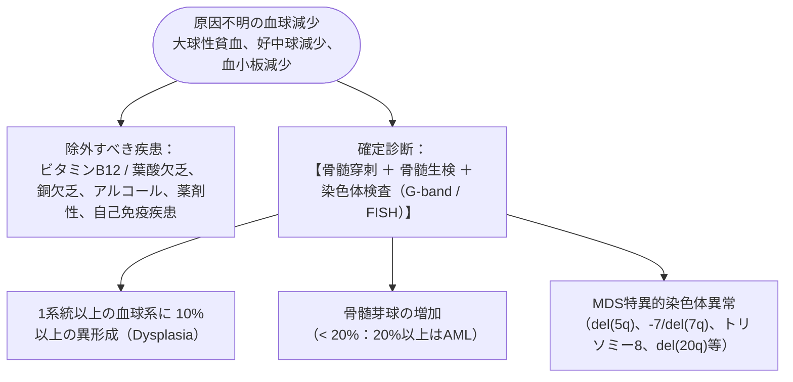

# 骨髄異形成症候群 (MDS)
親カテゴリ: [[clinical-flows/H_血液/index|H章 血液]]

## 疾患概念と診断基準（WHO 2017準拠）

造血幹細胞のクローン性異常による**無効造血（末梢血球減少 ＋ 骨髄正〜過形成）** と、急性骨髄性白血病 (AML) への移行リスクを特徴とする腫瘍性疾患[cite: 644, 646]。

---

## 予後予測リスク分類：IPSS-R (Revised IPSS)

骨髄芽球比率、染色体異常分類、Hb値、血小板数、好中球数の5項目でスコアリング（Very Low, Low, Intermediate, High, Very High）[cite: 647, 648]：
- **低リスク群 (Very Low / Low / Intermediateの一部)**:
  - 主な死因は血球減少に伴う感染・出血や輸血後鉄過剰症[cite: 646, 647, 649]。治療目標は「QOL向上と血球減少の改善（輸血非依存化）」[cite: 648, 649]。
- **高リスク群 (High / Very High / Intermediateの一部)**:
  - 早期にAML転化を来し予後不良（生存期間中央値 $<1.6$ 年）[cite: 646, 647, 648]。治療目標は「白血病転化抑制と全生存期間の延長」[cite: 648, 649]。

---

## 病態・リスク別治療プロトコル

### 1. 低リスク群の治療
- **無症状・輸血不要**: 原則として無治療で経過観察[cite: 645, 648]。
- **症候性貧血・輸血依存例**:
  - **エリスロポエチン製剤 (ESA: ダルベポエチン 240 µg/週 皮下注)**: 内因性血清EPO $<500\ \mathrm{mIU/mL}$ かつ輸血量 $<4$ 単位/月で奏効率良好[cite: 648, 649]。
  - **5q欠失症候群 (MDS with isolated del(5q))**: **レナリドミド（レブラミド 10 mg/日）** が極めて著効（約70%で輸血離脱）[cite: 649]。
  - **環状鉄芽球を伴うMDS (MDS-RS)**: **ラスパテルセプト（1.0〜1.75 mg/kg 3週毎皮下注）**[cite: 649]。

### 2. 高リスク群の治療
- **同種造血幹細胞移植 (Allogeneic HCT)**:
  - **唯一の根治的治療**[cite: 649]。65〜70歳未満でドナーがあり、重篤な併存症のない症例で最優先に検討[cite: 649, 650]。
- **移植非適応例**:
  - **アザシチジン（ビダーザ 75 mg/m²/日 皮下注または点滴静注 7日間投与、4週間毎）**: 生存期間延長および白血病転化遅延をもたらす標準療法[cite: 650]。

> [!NOTE]- MDSに伴う全身性自己免疫疾患の合併
> MDS患者の約10〜20%に、**Sweet病、壊死性膿皮症、巨細胞性動脈炎、多発関節炎、Behçet病様症状**が併発する[cite: 644, 651, 652]。ステロイド治療やアザシチジンがこれらの自己炎症症状の沈静化にも有効である[cite: 652]。
