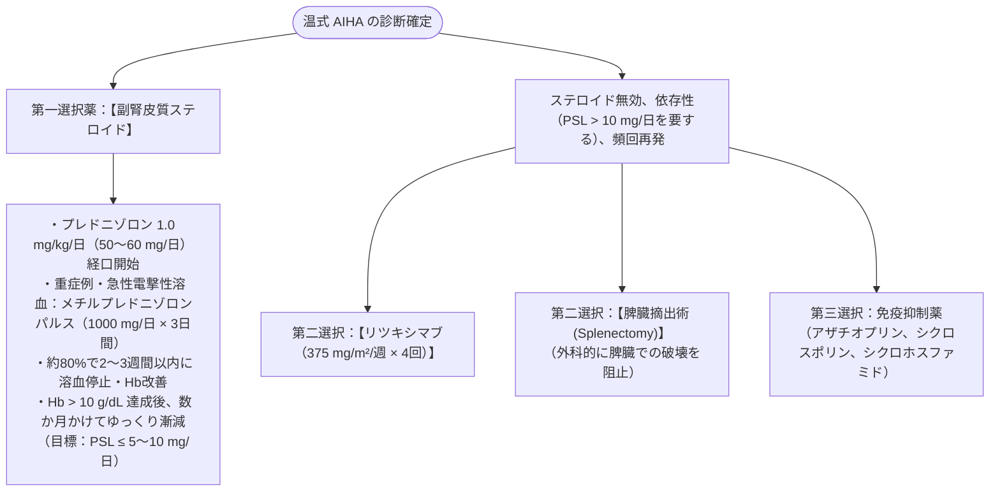

# 自己免疫性溶血性貧血 (AIHA)
親カテゴリ: [[clinical-flows/H_血液/index|H章 血液]]

## 温式 AIHA vs 冷式 AIHA (寒冷凝集素症 CAD)

自己抗体が赤血球膜抗原に結合して溶血を惹起する疾患[cite: 653]。

| 項目 | 温式 AIHA (Warm AIHA) | 寒冷凝集素症 (CAD / 冷式AIHA) |
| :--- | :--- | :--- |
| **頻度** | **AIHAの70〜80%（最多）**[cite: 653] | AIHAの15〜20%[cite: 653, 658] |
| **原因抗体** | **IgG**（主に37℃で結合）[cite: 653] | **IgM**（4℃等の低温で結合、寒冷凝集素）[cite: 653, 658] |
| **溶血の機序** | 主に**血管外溶血**（脾臓マクロファージによる貪食）[cite: 653] | 主に**補体介在性溶血**（肝臓クッパー細胞、血管内溶血）[cite: 653, 658, 659] |
| **直接Coombs試験** | **IgG単独陽性、または IgG ＋ C3d陽性**[cite: 653] | **C3d単独陽性（IgGは陰性）**[cite: 653] |
| **寒冷凝集素価** | 正常範囲（$<64$ 倍）[cite: 654] | **著明高値（$\ge64$ 倍、しばしば $\ge512$ 倍）**[cite: 653, 654] |
| **誘因・背景** | 特発性（50%）、SLE、悪性リンパ腫、薬剤性[cite: 653, 655] | マイコプラズマ、EBウイルス、B細胞性リンパ増殖症[cite: 653, 658] |

---

## 温式 AIHA の治療プロトコル

---

## 寒冷凝集素症 (CAD) の特異的治療

> [!WARNING]- 温式AIHA治療の無効性
> 冷式AIHA（CAD）に対しては、**副腎皮質ステロイドおよび脾臓摘出術はほぼ無効**である（溶血が脾臓ではなく肝臓および血管内で生じるため）[cite: 658]。温式と同じ治療を行ってはならない[cite: 658]。

1. **防寒・保温の徹底（基本治療）**: 頭部、四肢末端の寒冷曝露を避ける[cite: 658]。輸液・輸血時は必ず37℃に加温する[cite: 653, 658]。
2. **薬物療法**:
   - **リツキシマブ単剤**（または ベンダムスチン併用）：異常IgM産生B細胞クローンを根絶[cite: 658, 659]。
   - **スチムリマブ（エジャイモ）**: C1s阻害抗体（古典的補体経路を遮断し溶血を急速に停止）[cite: 658, 659]。
3. **血漿交換療法**: 急性重症溶血や開心術前の急性期除水・IgM除去に有効[cite: 658]。
