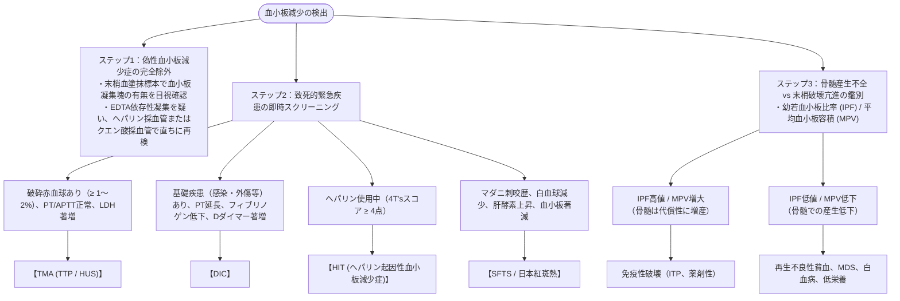

# 血小板減少のアセスメント
親カテゴリ: [[clinical-flows/H_血液/index|H章 血液]]

## 急性血小板減少の鑑別アルゴリズム

血小板数 $<15$ 万/$\mu\mathrm{L}$ またはベースラインから50%以上の急激な低下[cite: 660]。

---

## ヘパリン起因性血小板減少症 (HIT) の 4T's スコア

ヘパリン投与開始後**5〜10日目**に、血小板数が**50%以上急落**した場合に疑う[cite: 666, 667]。

- **T**hrombocytopenia: 血小板50%以上減少 かつ 最低値 $\ge2$ 万 (2点)[cite: 667]
- **T**iming: ヘパリン開始後5〜10日目（過去30日以内投与歴あれば1日以内）に発症 (2点)[cite: 667]
- **T**hrombosis: 新規血栓塞栓症（深部静脈血栓、肺塞栓、皮膚壊死等）の出現 (2点)[cite: 667]
- o**T**her causes: 他の血小板減少原因が全くない (2点)[cite: 667]
- **判定**: **6〜8点（高リスク）**、**4〜5点（中リスク）**[cite: 667]。

> [!WARNING]- HITに対する緊急初期対応
> 4T'sスコア $\ge4$ 点では抗体結果を待たずに介入する[cite: 667]：
> 1. **すべてのヘパリン（末梢ラインのヘパリンフラッシュ含む）を直ちに中止**[cite: 666, 667]。
> 2. 代替抗凝固薬として**アルガトロバン（スロンノン）**の持続静注を開始（HITは出血ではなく致死的な動静脈血栓症を続発するため、抗凝固療法の中止は厳禁）[cite: 666, 667]。
> 3. 血小板輸血は血栓症を悪化させるため原則禁忌。
