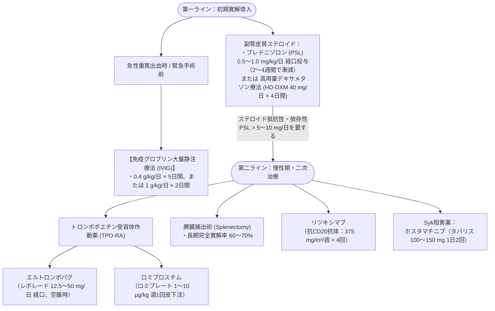

# 自己免疫性血小板減少症 (ITP)
親カテゴリ: [[clinical-flows/H_血液/index|H章 血液]]

## 診断の要点
血小板膜蛋白（GPIIb/IIIa等）に対する自己抗体による**血小板破壊亢進 ＋ 骨髄での産生不全**[cite: 670]。
- **除外診断**: 他系統の血球減少（貧血・白血球減少）がなく、脾腫を認めず、骨髄異形成や他疾患が除外されること[cite: 670, 671]。
- **二次性ITPのスクリーニング**: **H. pylori感染**（呼気試験）、**HCV / HIV**、抗核抗体・抗リン脂質抗体（SLE合併）を全例で評価[cite: 670, 672, 673]。

---

## 治療開始の適応基準

治療目的は「血小板数の完全正常化」ではなく、**「致命的出血を回避できる安全な血小板数（約 $>2〜3$ 万/$\mu\mathrm{L}$）の維持」** である[cite: 670, 673]：
- **血小板 $\ge3$ 万/$\mu\mathrm{L}$ かつ 無症状（紫斑のみ）**: 原則として薬物治療を行わず**経過観察**[cite: 671, 673]。
- **血小板 $<2〜3$ 万/$\mu\mathrm{L}$、または粘膜出血・活動性出血あり**: 治療適応[cite: 671, 673]。
- **H. pylori 陽性例**: 治療適応の有無に関わらず、まず**ピロリ除菌療法を先行**（約50〜60%で血小板回復）[cite: 673]。

---

## 治療ステッププロトコル

