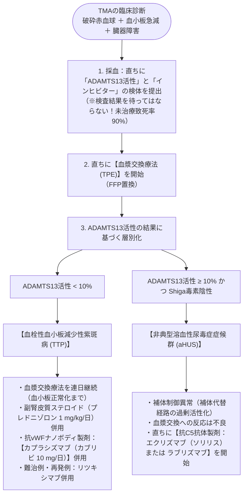

# 血栓性微小血管障害症 (TMA)
親カテゴリ: [[clinical-flows/H_血液/index|H章 血液]]

## 病態概念と2大主徴
全身の微小血管内に血小板血栓が多発し、以下の2徴を呈する致死性疾患群[cite: 685, 686]：
1. **微小血管症性溶血性貧血 (MAHA)**: 破砕赤血球出現（$\ge1〜2\%$）、間接ビリルビン上昇、LDH著明高値、ハプトグロビン枯渇、直接Coombs陰性[cite: 686]。
2. **消費性血小板減少**: しばしば $<2\sim3$ 万/$\mu\mathrm{L}$ の高度低下[cite: 687, 688]。
3. ※**凝固検査（PT, APTT, フィブリノゲン）がほぼ正常範囲に保たれる**点がDICとの決定的鑑別点[cite: 687, 688]！

---

## TTP vs 非典型HUS (aHUS) の鑑別と治療

> [!WARNING]- 血小板輸血の原則禁忌
> TTPが疑われる患者に対する安易な血小板輸血は、微小血栓形成の「火に油を注ぐ」ことになり、**脳梗塞、心筋梗塞、急死を誘発するため絶対禁忌**である[cite: 685, 686]。生命に関わる致死的頭蓋内出血等を除き、血小板輸血を行ってはならない。
