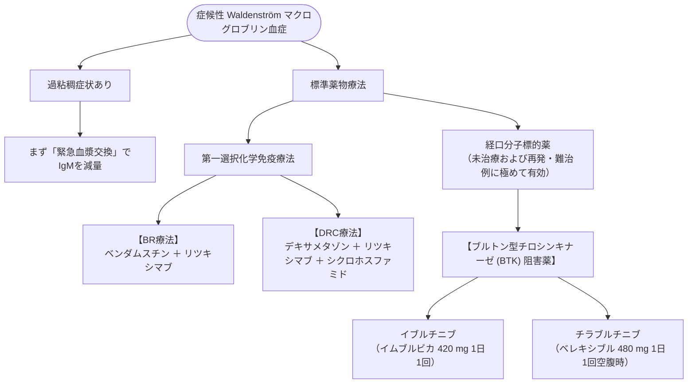

# Waldenström マクログロブリン血症 (WM)
親カテゴリ: [[clinical-flows/H_血液/index|H章 血液]]

## 疾患概念と診断
骨髄中にリンパ形質細胞性リンパ腫（LPL）の浸潤を認め、**血清単クローン性 IgM 高値** を呈する低悪性度B細胞腫瘍[cite: 724]。
- **遺伝子変異**: **MYD88 L265P 変異が $>90\%$ の症例で陽性**（多発性骨髄腫との決定的な鑑別点）[cite: 724, 725]。
- **主症状**: 正球性貧血、肝脾腫・リンパ節腫大、B症状（寝汗・発熱・体重減少）、**過粘稠度症候群**、末梢神経障害、寒冷凝集素症[cite: 724, 725]。

---

## 過粘稠度症候群 (Hyperviscosity Syndrome) の緊急対応

血清IgM濃度が **$>3000\sim4000\ \mathrm{mg/dL}$** を超えると、血液粘度上昇により微小循環障害を来す[cite: 726]。

> [!WARNING]- 過粘稠度症候群の警告徴候
> - **粘膜出血**: 難治性鼻出血、歯肉出血、網膜静脈拡張・ソーセージ様怒張・眼底網膜出血（視力障害）[cite: 726]。
> - **中枢神経症状**: 頭痛、めまい、意識混迷、難聴、失調、脳卒中様発作[cite: 726]。
> - **心血管系**: 高拍出性心不全[cite: 726]。
> - **緊急処置**: **直ちに「治療的血漿交換療法 (TPE)」を実施**して血清IgMを急速除去する[cite: 725, 726]。化学療法開始を先行させてはならない[cite: 725]。

---

## 治療プロトコル

無症候性（Smoldering WM）は無治療経過観察[cite: 724, 726]。血球減少、臓器腫大、過粘稠症状を伴う症候性WMで治療開始[cite: 725, 726]。

> [!WARNING]- リツキシマブ単独投与時の「IgM フレア」
> 高IgM血症患者にリツキシマブを単剤投与すると、投与直後に**一過性のIgM急上昇（IgM flare：最大で約50%に発生）** を来し、致死的な過粘稠度症候群や心不全を誘発する[cite: 725, 726]。
> 血清IgM $>4000\ \mathrm{mg/dL}$ の症例では、リツキシマブ単剤投与を避け、血漿交換を先行させるか、BTK阻害薬や多剤併用療法を選択する[cite: 726]。
