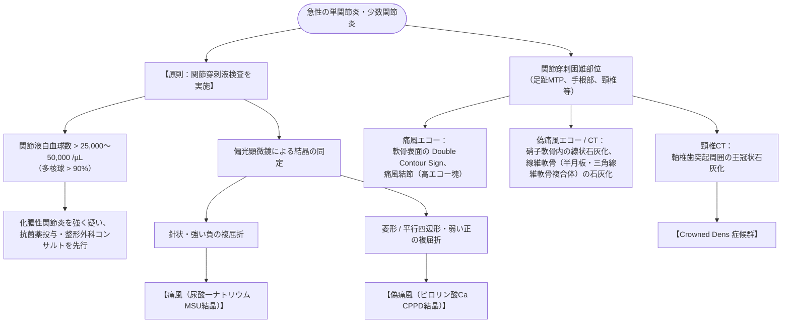

# 結晶誘発性関節炎：痛風、偽痛風
親カテゴリ: [[clinical-flows/I_自己免疫・炎症性疾患/index|I章 自己免疫・炎症性疾患]]

## 救急初期アセスメントと化膿性関節炎の除外

急性の単関節炎・少数関節炎では、**関節穿刺液検査による化膿性関節炎の除外**が最優先[cite: 729]。

> [!WARNING]- 結晶証明と化膿性関節炎の併発ピットフォール
> 関節液中に尿酸結晶やCPPD結晶が証明されても、**約1.5〜5%で化膿性関節炎が合併**している[cite: 732]。結晶があっても関節液白血球数が $>50,000\ /\mu\mathrm{L}$ を超える場合や、発熱・感染徴候が強い場合は、細菌培養結果が出るまで抗菌薬を併用する[cite: 730, 732]。

---

## 急性期抗炎症治療プロトコル

急性発作時は速やかに抗炎症薬を開始し、**尿酸降下薬の新規開始や増量は発作消退まで延期**する（既存内服中はそのまま継続）[cite: 737]。

1. **NSAIDs（第一選択）**:
   - 短期大量投与：ナプロキセン（ナイキサン 600〜900 mg/日）または ロキソプロフェン（180 mg/日）を発作開始直後から投与し、寛解に伴い漸減[cite: 733]。
2. **コルヒチン**:
   - **発症後早期（36時間以内）**: 初回 1.0 mg 内服 → 1時間後に 0.5 mg 内服（以後 0.5〜1.0 mg/日）[cite: 733]。
   - ※腎機能障害（eGFR $<50$）や高齢者、CYP3A4/P-gp阻害薬併用時は減量（0.25〜0.5 mg/日または隔日投与）[cite: 733, 734]。
3. **副腎皮質ステロイド（NSAIDs/コルヒチン禁忌・無効例）**:
   - プレドニゾロン 20〜30 mg/日（0.5 mg/kg/日）を5〜10日間投与し漸減中止[cite: 733]。
   - 単関節炎（膝など）であればトリアムシノロン等の関節腔内注入が極めて有効[cite: 733]。

---

## 痛風慢性期：高尿酸血症の管理基準

発作完全消退の2〜4週間後から導入する[cite: 737]。

- **治療目標値**: **血清尿酸値 $<6.0\ \mathrm{mg/dL}$**（痛風結節・重症例では $<5.0\ \mathrm{mg/dL}$）[cite: 737]。
- **尿酸降下薬の選択**:
  - **アロプリノール（ザイロリック 100 mg/日より開始し 200〜300 mg/日へ漸増）**: コストパフォーマンスに優れるが、重症薬疹（DIHS/Stevens-Johnson）やHLA-B*58:01保有者に注意[cite: 736, 737, 738]。
  - **フェブキソスタット（フェブリク 10 mg/日より開始し 40〜60 mg/日へ漸増）**: 腎機能低下例でも使用しやすい[cite: 737, 738]。
- **発作予防**: 尿酸降下薬導入初期の急激な尿酸値変動による発作誘発（Mobilization flare）を防ぐため、**コルヒチン 0.5 mg/日 を最初の3〜6か月間カバー併用**する[cite: 738]。
