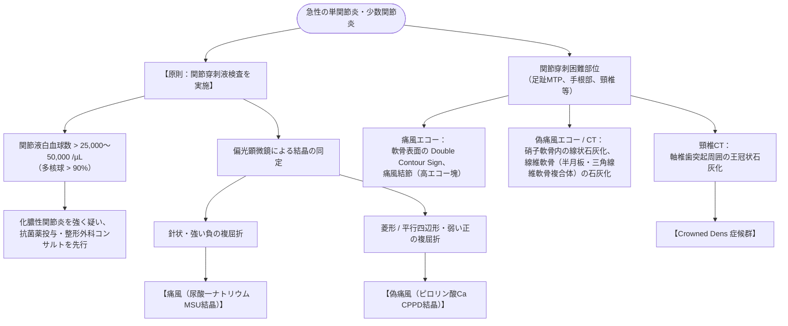

# 関節リウマチ (RA)
親カテゴリ: [[clinical-flows/I_自己免疫・炎症性疾患/index|I章 自己免疫・炎症性疾患]]

## 診断基準（ACR/EULAR 2010 分類基準）

他疾患が除外された、少なくとも1つ以上の臨床的滑膜炎（関節腫脹）を有する患者において、**合計スコア $\ge6/10$ 点**で関節リウマチと分類[cite: 740]：

1. **罹患関節の部位・数 (0〜5点)**:
   - 大関節 1個 (0点)、大関節 2〜10個 (1点)、小関節 1〜3個 (2点)、小関節 4〜10個 (3点)、小関節1個以上を含む 10個超の関節 (5点)[cite: 740]
2. **血清学的検査 (0〜3点)**:
   - RF および 抗CCP抗体ともに陰性 (0点)、いずれかが低力価陽性 (2点)、いずれかが高力価陽性 (3点)[cite: 740]
3. **急性期反応物質 (0〜1点)**:
   - CRP または ESR 正常 (0点)、いずれかが異常高値 (1点)[cite: 740]
4. **症状の持続期間 (0〜1点)**:
   - 6週間未満 (0点)、6週間以上 (1点)[cite: 740]

---

## Treat to Target (T2T) 治療戦略アルゴリズム

目標は**臨床的寛解（SDAI $\le3.3$、CDAI $\le2.8$）または低疾患活動性の達成と維持**[cite: 740, 741, 751]。

---

## 生物学的製剤・JAK阻害薬導入前のスクリーニング

> [!WARNING]- 導入前の必須感染症評価
> 1. **結核**: インターフェロン-γ遊離試験（IGRA：T-SPOT/QFT）＋ 胸部CT[cite: 801, 802]。陽性時は**イソニアジド（300 mg/日）を生物学的製剤開始3〜4週間前から先行投与**し、計6〜9か月間継続[cite: 801, 802]。
> 2. **B型肝炎**: HBs抗原、HBs抗体、HBc抗体測定[cite: 800, 801]。HBc抗体またはHBs抗体陽性（既往感染）例では、定期的なHBV-DNA定量（モニタリング）を行う[cite: 800, 801]。
> 3. **帯状疱疹**: 特にJAK阻害薬使用時は高頻度に発症するため、導入前に組換え不活化帯状疱疹ワクチン（シングリックス）接種を推奨[cite: 795]。

> [!NOTE]- 長期罹患患者における「頸椎病変（環軸椎亜脱臼 AAS）」の監視
> 罹患期間が長い症例では、環軸椎亜脱臼（AAS: 前屈位頸椎X線で環椎歯突起間距離 $>3\ \mathrm{mm}$）や垂直亜脱臼（VS）を合併しやすい[cite: 797, 798]。全身麻酔時の気管挿管や転倒で脊髄圧迫・急死を招くため、術前や有症状時には必ず頸椎動態X線を評価する[cite: 797, 798]。
