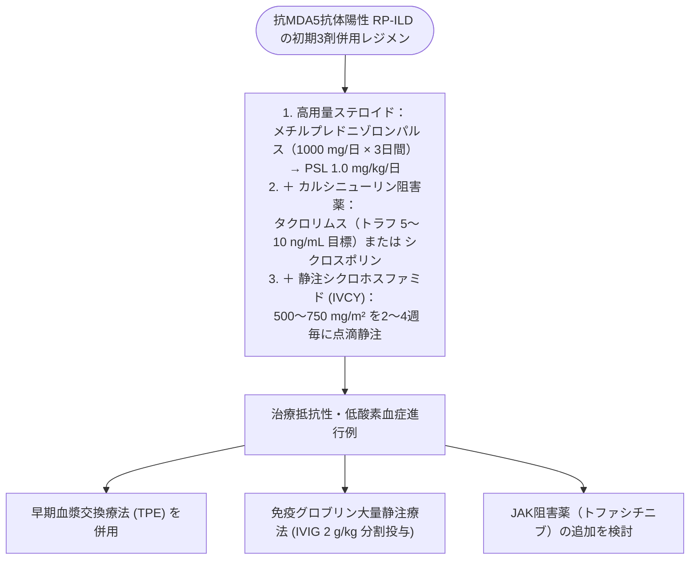

# 特発性炎症性筋症 (IIM)、抗ARS抗体症候群
親カテゴリ: [[clinical-flows/I_自己免疫・炎症性疾患/index|I章 自己免疫・炎症性疾患]]

## 筋炎特異的自己抗体 (MSAs) と臨床フェノタイプ

特発性炎症性筋症は、血清特異抗体により臨床病型・合併症・予後が明確に層別化される[cite: 809, 810]：

| 自己抗体 | 主要疾患フェノタイプ | 筋・皮膚・肺病変の特徴 | 悪性腫瘍リスク |
| :--- | :--- | :--- | :--- |
| **抗MDA5抗体** | **CADM（臨床的無筋症性皮膚筋炎）**[cite: 809, 812] | 筋力低下・CK上昇はごく軽度[cite: 809, 810]。**急速進行性間質性肺炎 (RP-ILD)** を高率に併発[cite: 809, 810]。手指皮膚潰瘍、逆Gottron徴候[cite: 810, 811]。 | 低い[cite: 810] |
| **抗ARS抗体**（抗Jo-1、抗PL-7、抗PL-12等） | **抗ARS抗体症候群 (ASS)**[cite: 809, 810] | 慢性間質性肺炎 (NSIP/OP)、筋炎、多発関節炎（RA様）、**機械工の手（Mechanic's hands）**、Raynaud現象[cite: 809, 810, 811]。 | 低い[cite: 810] |
| **抗TIF1-$\gamma$抗体** | 高齢者皮膚筋炎[cite: 809, 810] | 典型的な広範な皮膚筋炎皮疹（Vサイン・ショールサイン）[cite: 809, 810]。筋炎は中等度[cite: 810]。 | **極めて高頻度（約50〜70%に内臓癌合併）**[cite: 810, 814] |
| **抗Mi-2抗体** | 古典的皮膚筋炎[cite: 809, 810] | 典型的なヘリオトロープ疹・Gottron丘疹[cite: 809, 810]。筋炎は明瞭だが**ステロイド反応性極めて良好**[cite: 810]。 | 低い[cite: 810] |
| **抗HMGCR抗体** / **抗SRP抗体** | **自己免疫性壊死性筋症 (IMNM)**[cite: 809, 810] | **血清CK著明高値（数千〜数万）**、急速進行性の対称性近位筋脱力[cite: 809, 810]。皮疹・肺病変なし[cite: 810]。抗HMGCRはスタチン曝露関連[cite: 809, 810]。 | 抗体陰性IMNM・HMGCRで注意[cite: 810, 814] |

---

## 抗MDA5抗体陽性・急速進行性間質性肺炎 (RP-ILD) の超緊急治療

> [!WARNING]- 検査結果を待たずに3剤併用療法を即時導入
> 抗MDA5抗体陽性例のRP-ILDは、数日から数週間で不可逆的呼吸不全・死に至る（未治療死亡率 $>50〜80\%$）[cite: 810, 814]。皮膚潰瘍や逆Gottron徴候、高フェリチン血症（$>500\sim1000\ \mathrm{ng/mL}$）を認めたら、**抗体結果を待たずに直ちに初期3剤強力併用療法を開始**する[cite: 814]：

---

## 一般的な特発性筋炎の標準治療

- **初期寛解導入**:
  - **プレドニゾロン (PSL) 0.75〜1.0 mg/kg/日**（重症筋力低下・嚥下障害時はmPSLパルス先行）[cite: 813]。
  - 筋力回復およびCK値改善を確認後、数週間後から 10%/2〜4週のペースでゆっくり漸減[cite: 813]。
- **早期免疫抑制薬併用**:
  - ステロイド抵抗性予防およびステロイド離脱を目的に、初診時より**アザチオプリン（2 mg/kg/日）** または **メトトレキサート**（間質性肺炎合併時はメトトレキサート回避）、**タクロリムス**を併用する[cite: 813, 814]。
- **全身スクリーニング**: 皮膚筋炎（特に高齢者、抗TIF1-$\gamma$、抗NXP-2抗体陽性）と診断したら、必ず**全身CT、上下部内視鏡、PET/CTによる悪性腫瘍検索**を施行する[cite: 810, 814]。
