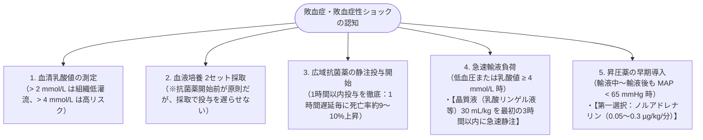

# 敗血症の初療
親カテゴリ: [[clinical-flows/J_感染症/index|J章 感染症]]

## 定義と診断基準（Sepsis-3 準拠）

感染症に対する生体反応の調節破綻により、生命を脅かす臓器障害を来した状態[cite: 829]。

- **ベッドサイド・救急トリアージ（qSOFA）**:
  - 以下の3項目中 **2項目以上** で敗血症を強く疑う[cite: 829]：
    1. **呼吸数 $\ge22$ 回/分**[cite: 829]
    2. **意識変容**（GCS $<15$、または普段と異なる）[cite: 829]
    3. **収縮期血圧 $\le100\ \mathrm{mmHg}$**[cite: 829]
- **臓器障害の確定（SOFA スコア）**:
  - 感染症を契機とした **SOFAスコアのベースラインから2点以上の増加**[cite: 829]。
- **敗血症性ショック (Septic Shock)**:
  - 適切な輸液負荷後も **平均動脈圧 (MAP) $\ge65\ \mathrm{mmHg}$ 維持に昇圧薬を要し**、かつ **血清乳酸値 $>2.0\ \mathrm{mmol/L}$ ($>18\ \mathrm{mg/dL}$)**[cite: 829]。

---

## 初期蘇生バンドル（Hour-1 Bundle）

敗血症を認知・疑った時点から **1時間以内** に以下を並行して完了する[cite: 829, 835]：

---

## 輸液反応性と微小循環のベッドサイド評価

> [!NOTE]- モニタリングの要点（マクロ血流からミクロ循環へ）
> - **Mottling Score (膝の網状皮斑)**: 膝周囲の斑状チアノーゼの広がり（0〜5点）[cite: 831, 832]。Mottlingスコア $\ge2$ 点は乳酸値上昇・臓器不全・死亡率と直結する[cite: 831]。
> - **毛細血管再充満時間 (CRT)**: 示指末節を圧迫解除後、血色が戻るまで **$\ge4$ 秒** は末梢低灌流（ANDROMEDA-SHOCK試験：CRT正常化を指標とした蘇生管理が有用）[cite: 829, 831, 832]。
> - **Shock Index (心拍数 / 収縮期血圧)**: **$>0.7〜0.8$** は潜在性ショック・急変の警告徴候[cite: 829, 831]。
> - **下大静脈 (IVC) 呼吸性変動**: 自発呼吸下で呼気時虚脱率 $<50\%$ または 径 $>20\ \mathrm{mm}$ は輸液不応性・うっ血を示唆[cite: 831]。

---

## 難治性ショックに対する補助療法

- **バソプレシン併用**:
  - ノルアドレナリン増量時（$>0.25\ \mu\mathrm{g/kg/min}$）に、低用量バソプレシン（0.01〜0.03 U/min）を併用してカテコラミン必要量を削減[cite: 832, 834, 835]。
- **副腎皮質ステロイド（Corticosteroids）**:
  - 輸液負荷と高用量昇圧薬でも血行動態が安定しない敗血症性ショックに対し、**ヒドロコルチゾン（ソル・コーテフ 200 mg/日 持続点滴、または 50 mg 6時間毎）** を投与（ショック離脱期間短縮）[cite: 833, 834]。
