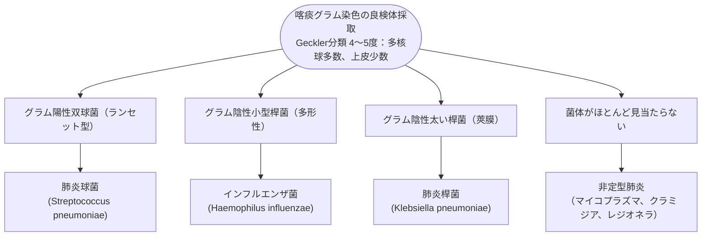

# 細菌性肺炎
親カテゴリ: [[clinical-flows/J_感染症/index|J章 感染症]]

## 重症度分類と入院適応（A-DROP / CURB-65）

外来・一般病棟・ICU管理の判断には客観的スコアリングを用いる[cite: 838]：

### CURB-65 スコア
- **C**onfusion: 意識障害（新基準 GCS $<15$ 等）[cite: 838]
- **U**rea: BUN $>19\ \mathrm{mg/dL}$[cite: 838]
- **R**espiratory rate: 呼吸数 $\ge30$ 回/分[cite: 838]
- **B**lood pressure: 血圧低下（収縮期 $<90$ または 拡張期 $\le60\ \mathrm{mmHg}$）[cite: 838]
- **65**: 年齢 $\ge65$ 歳[cite: 838]
- **判定**:
  - **0〜1点**: 低リスク（外来治療可能）[cite: 838]
  - **2点**: 中等症（入院加療を推奨）[cite: 838]
  - **$\ge3$ 点**: 重症（ICU/HCU管理、致死率 $>14\sim28\%$）[cite: 838]

---

## 起因菌の推定とエンピリック抗菌薬選択

### 病型別推奨抗菌薬
- **市中肺炎 (CAP) 外来・軽症**:
  - アモキシシリン/クラブラン酸（オーグメンチン等） または 高用量アモキシシリン[cite: 839]。
  - 非定型疑い：アジスロマイシン または レボフロキサシン[cite: 839]。
- **市中肺炎 (CAP) 入院・中等症〜重症**:
  - **アンピシリン/スルバクタム（ユナシンS 1.5〜3.0 g 6時間毎）** または **セフトリアキソン（ロセフィン 1〜2 g 24時間毎）**[cite: 839, 840]。
  - 重症・ICU管理：CTRX ＋ アジスロマイシン点滴（非定型・レジオネラ併用カバー）[cite: 839, 840]。
- **院内肺炎 (HAP) / 医療・介護関連肺炎 (HCAP)**:
  - 耐性菌（緑膿菌・腸内細菌目）カバー：**ピペラシリン/タゾバクタム（ゾシン 4.5 g 6時間毎）** または **セフェピム（2 g 8時間毎）** または **メロペネム（1 g 8時間毎）**[cite: 839, 840]。
  - MRSA高リスク（喀痰グラム染色GPC集塊、保菌歴、透析等）：バンコマイシン併用[cite: 839, 840]。

---

## 治療効果判定と投与期間

> [!WARNING]- 臨床的安定後の短期治療（治療期間 5〜7日間）
> 抗菌薬開始後 **48〜72時間** で解熱傾向、呼吸数、酸素化、喀痰性状（局所パラメータ）を評価する[cite: 841, 842]。
> 解熱後48時間以上経過し、バイタルサインが安定していれば、**総投与期間 5〜7日間で抗菌薬を終了可能**である（漫然とした長期投与は耐性菌・CDIを招く）[cite: 841, 842]。

> [!NOTE]- 誤嚥性肺炎 vs 誤嚥性肺臓炎（化学性肺臓炎）
> 明らかな誤嚥を目撃された直後の発熱・浸潤影であっても、細菌感染ではなく胃酸による化学的刺激（Mendelson症候群）である場合が多い[cite: 839, 840]。全身状態が安定していれば抗菌薬を即座に投与せず、24〜48時間経過観察することも許容される[cite: 839, 840]。
