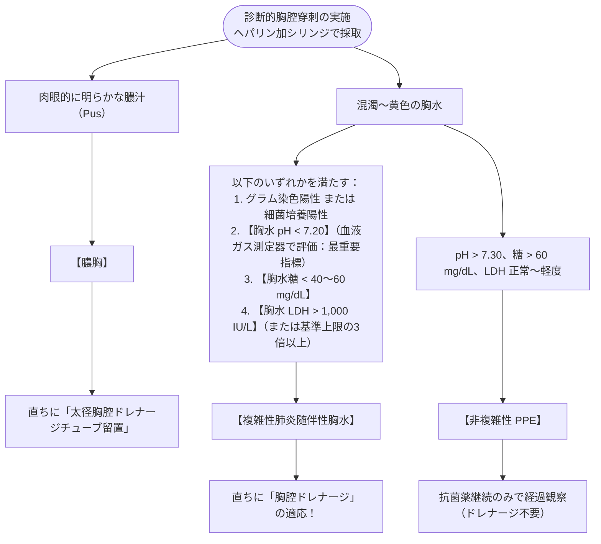

# 膿胸、肺炎随伴性胸水
親カテゴリ: [[clinical-flows/J_感染症/index|J章 感染症]]

## 病期分類と病態進行
肺炎の約20〜57%に胸水（肺炎随伴性胸水 PPE）が合併する[cite: 844]。

1. **非複雑性肺炎随伴性胸水 (Simple PPE)**:
   - 滲出性胸水だが無菌性[cite: 844]。抗菌薬全身投与のみで自然消退する[cite: 844, 845]。
2. **複雑性肺炎随伴性胸水 (Complicated PPE)**:
   - 細菌が胸腔内に侵入し、アシドーシスと線維素（フィブリン）沈着が進行[cite: 844, 845]。**持続胸腔ドレナージが必須**[cite: 844, 845]。
3. **膿胸 (Empyema)**:
   - 肉眼的に膿性の胸水[cite: 844, 845]。多房化・器質化（線維性被膜形成）を来す[cite: 844, 845]。

---

## 胸腔穿刺と胸水検査によるトリアージ

超音波または側臥位X線で **胸水層 $\ge10\ \mathrm{mm}$（1 cm）** を認めたら、診断的胸腔穿刺を施行する[cite: 844, 845]。

---

## 治療プロトコル

### 1. 抗菌薬治療
- 口腔内常在菌（嫌気性菌、*Streptococcus anginosus* 群）および肺炎球菌・腸内細菌を標的とする[cite: 846]。
- **アンピシリン/スルバクタム（ユナシンS 3.0 g 6時間毎）**、**タゾバクタム/ピペラシリン**、重症例は**カルバペネム系**[cite: 839, 846]。
- ※アミノグリコシド系は胸腔移行性が悪く、酸性下で失活するため無効[cite: 846]。
- 投与期間は最低3週間（臨床症状、CRP、画像所見を確認して決定）[cite: 846]。

### 2. 多房性・ドレナージ不良例に対する介入
- **胸腔内線溶療法 (Intrapleural Fibrinolytic Therapy)**:
  - フィブリン隔壁によりドレナージが進まない場合、**ウロキナーゼ（約12〜24万単位を生食100 mLに希釈）** を胸腔内に注入し、1〜2時間クランプ後に開放吸引[cite: 846, 847]。
- **早期外科的手術 (VATS：胸腔鏡下膿胸腔掻爬・デブリードマン)**:
  - 線溶療法やドレナージで改善しない場合、器質化（Trapped lung）が完成する前に**発症後数日〜1週間以内に呼吸器外科へコンサルト**する[cite: 845, 847]。
