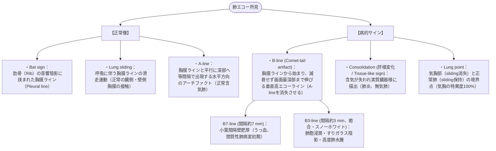

# 肺エコー
親カテゴリ: [[clinical-flows/J_感染症/index|J章 感染症]]

## 肺エコーの基本サイン（肺二次小葉の理解）

肺超音波は空気と水分の音響インピーダンス差を利用し、CTに匹敵する診断能をベッドサイドで発揮する[cite: 856]。

---

## 臨床シナリオ別アプローチ

### 1. 急性呼吸困難の鑑別（BLUE プロトコル準拠）
- **両側びまん性 B-line（B-profile）**:
  - **心原性肺水腫**: 胸膜ラインは整、下大静脈（IVC）拡大・虚脱消失、両側胸水[cite: 857, 858, 859]。
  - **ARDS**: 胸膜ラインの不整・肥厚、局所的無気肺（Subpleural consolidation）、Spared area（正常部混在）[cite: 857, 859]。
- **前胸部 A-line ＋ Lung sliding 消失（A'-profile）**:
  - 気胸を疑い、外側へプローブを移動させて **Lung point** を探索（確認できれば気胸確定）[cite: 856, 858]。
- **局所的 Consolidation ＋ 破片サイン (Shred sign)**:
  - 細菌性肺炎（内部に点状・線状の高エコー：Air bronchogram を認める）[cite: 857, 858]。

### 2. 集中治療・輸液管理の指標
- **A-line 主体の肺（Dry lung）**:
  - 肺動脈楔入圧 $\le13\ \mathrm{mmHg}$ を示唆し、心不全悪化を招かずに安全に輸液負荷が可能[cite: 859, 860, 861]。
- **B-line の出現・増加（Wet lung）**:
  - 血管外肺水分量（EVLW）の増加を鋭敏に反映。輸液を減量・中止し、利尿薬導入の指標とする[cite: 859, 860, 861]。
