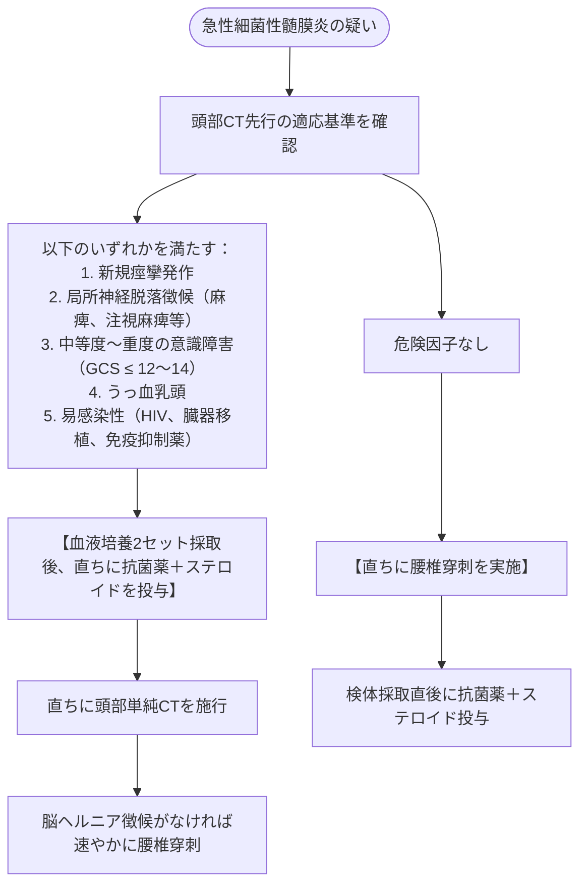

# 髄膜炎
親カテゴリ: [[clinical-flows/J_感染症/index|J章 感染症]]

## 救急初期アセスメントと腰椎穿刺の判断

発熱、頭痛、意識障害、項部硬直を認めたら直ちに中枢神経感染症を疑う[cite: 867, 868]。

> [!WARNING]- 検査による抗菌薬遅延の絶対回避
> 頭部CTや腰椎穿刺の手技に時間を要する場合、**いかなる場合も抗菌薬投与を遅らせてはならない**[cite: 867, 869, 875]。血液培養を採取した時点で、直ちにエンピリック抗菌薬を開始し、その後に検査を進める[cite: 867, 869, 875]。

---

## 髄液所見のパターン鑑別

| 鑑別点 | 正常 | 細菌性髄膜炎 | ウイルス性髄膜炎 | 結核性 / クリプトコッカス |
| :--- | :--- | :--- | :--- | :--- |
| **初圧** | $10\sim20\ \mathrm{cmH_2O}$[cite: 870] | **著明上昇（$>20\sim30$）**[cite: 870] | 正常〜軽度上昇[cite: 870] | **著明上昇**[cite: 870] |
| **細胞数** | $<5\ /\mu\mathrm{L}$[cite: 870] | **著明増多（$>1,000$、好中球優位）**[cite: 870] | 軽〜中等度増多（$<500$、**リンパ球優位**）[cite: 870] | 中等度増多（$50〜500$、**リンパ球優位**）[cite: 870] |
| **蛋白** | $15〜45\ \mathrm{mg/dL}$[cite: 870] | **著明高値（$>100〜500$）**[cite: 870] | 軽度上昇（$<100$）[cite: 870] | **著明高値（$>100〜500$）**[cite: 870] |
| **糖比 (CSF/血清)** | $>0.6$[cite: 870] | **著明低下（$<0.4$、実値 $<40\ \mathrm{mg/dL}$）**[cite: 870, 871] | 正常（$>0.5〜0.6$）[cite: 870] | **著明低下（$<0.3$）**[cite: 870, 873] |
| **髄液乳酸値** | $<2.0\ \mathrm{mmol/L}$ | **$>3.5〜3.8\ \mathrm{mmol/L}$**（特異度97%）[cite: 871] | 正常（$<3.0$）[cite: 871] | 上昇（$>3.5$）[cite: 873] |

---

## エンピリック治療プロトコル

### 1. 市中発症・成人細菌性髄膜炎
- **抗菌薬**:
  - **セフトリアキソン（2 g 12時間毎点滴静注）**[cite: 875]
  - ＋ **バンコマイシン（15〜20 mg/kg 8〜12時間毎点滴静注：耐性肺炎球菌カバー）**[cite: 875]
  - ＋ **アンピシリン（2 g 4時間毎点滴静注：50歳以上、免疫不全、アルコール中毒、妊婦での *Listeria* カバー）**[cite: 875]
- **デキサメタゾンの先行併用（必須）**:
  - **デキサメタゾン 10 mg（0.15 mg/kg）を「抗菌薬初回投与の直前または同時」に静注**（6時間毎に4日間継続）[cite: 876]。
  - ※肺炎球菌性髄膜炎における死亡率・難聴・後遺症を有意に減少させる[cite: 876]。起因菌が肺炎球菌以外と判明した場合は中止[cite: 876]。

### 2. 単純ヘルペス脳炎 (HSE) の並行カバー
- 発熱、頭痛、急性精神錯乱、失語、側頭葉病変（MRI-FLAIR高信号）[cite: 873]。
- 診断確定（髄液HSV-DNA PCR）を待たずに、**アシクロビル（10 mg/kg 8時間毎 1時間かけて点滴静注）** を初期治療に必ず上乗せする[cite: 867, 873]。
