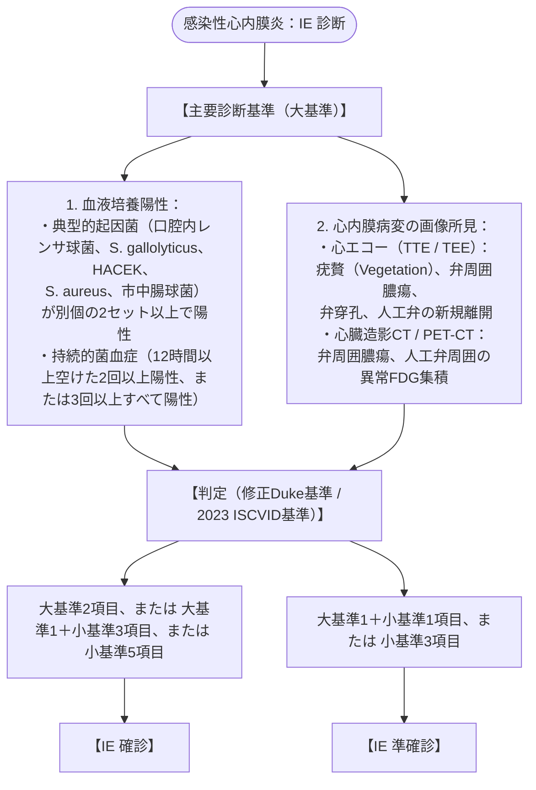

# 感染性心内膜炎 (IE)
親カテゴリ: [[clinical-flows/J_感染症/index|J章 感染症]]

## 疑うべき臨床シナリオと診断（Modified Duke 基準）

原因不明の発熱、心雑音、塞栓症状、またはハイリスク菌の菌血症で常に疑う[cite: 879]：

> [!NOTE]- 小基準のチェック項目
> 1. 心疾患（人工弁・弁膜症・心内デバイス）または静注薬物乱用[cite: 880]
> 2. 発熱（$\ge38.0^\circ\mathrm{C}$）[cite: 880]
> 3. 血管現象: 大動脈塞栓、敗血症性肺梗塞、感染性動脈瘤、頭蓋内出血、Janeway病変[cite: 880]
> 4. 免疫現象: 糸球体腎炎、Osler結節、Roth斑、リウマトイド因子 (RF) 陽性[cite: 880]
> 5. 微生物学的証拠: 大基準を満たさない血液培養陽性所見[cite: 880]

---

## 超音波検査の選択基準（TTE vs TEE）

- **経胸壁心エコー (TTE)**: スクリーニングとして全例施行（感度約50〜70%）[cite: 878, 879, 880]。
- **経食道心エコー (TEE)**: 感度 90〜95%、特異度 95%[cite: 880]。
  - **TEEの必須適応**:
    1. 人工弁、心内デバイス（ペースメーカ等）留置患者[cite: 878, 880, 890]
    2. *Staphylococcus aureus* 菌血症の全例[cite: 883]
    3. TTEで観察不良、またはTTE陰性だが臨床的疑いが強い症例[cite: 878, 880]
    4. 弁周囲膿瘍等の局所合併症の評価[cite: 878, 880]

---

## 緊急外科手術の3大適応

内科的抗菌薬治療のみで固執せず、**以下の兆候があれば直ちに心臓血管外科へ緊急コンサルト**する[cite: 878, 882]：

1. **心不全 (最重要・最多)**:
   - 急性大動脈弁・僧帽弁閉鎖不全による急性肺水腫、心原性ショック[cite: 882]。
2. **コントロール不能な局所感染**:
   - 弁輪部膿瘍、仮性動脈瘤、瘻孔形成、房室ブロック出現（中隔膿瘍進展）、適切な抗菌薬投与下での菌血症持続[cite: 882]。
3. **塞栓症の予防**:
   - 適切な治療にもかかわらず **疣贅径 $>10\ \mathrm{mm}$ で可動性**、あるいは塞栓症の反復[cite: 882]。
