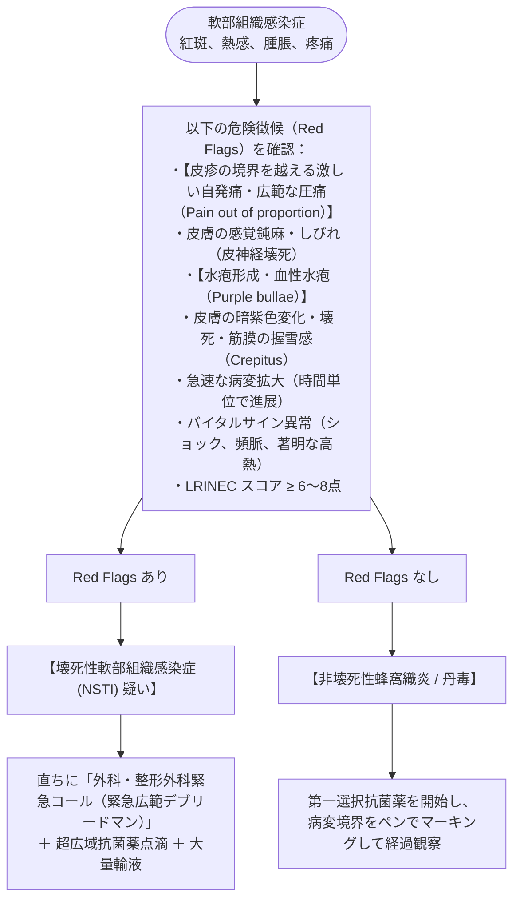

# 軟部組織感染症：蜂窩織炎、壊死性筋膜炎
親カテゴリ: [[clinical-flows/J_感染症/index|J章 感染症]]

## 蜂窩織炎 vs 壊死性筋膜炎 (NSTI) のトリアージ

軟部組織感染症を診た際、**最優先で壊死性筋膜炎（致死率30〜40%）をスクリーニング・除外**する[cite: 892]。

---

## 壊死性筋膜炎の補助診断：LRINEC スコア

血液生化学検査6項目によるリスク評価（合計13点満点）[cite: 893]：

- **CRP**: $\ge15\ \mathrm{mg/dL}$ (4点)[cite: 893]
- **白血球数**: $15,000〜25,000\ /\mu\mathrm{L}$ (1点) / $>25,000\ /\mu\mathrm{L}$ (2点)[cite: 893]
- **ヘモグロビン**: $11〜13.5\ \mathrm{g/dL}$ (1点) / $<11\ \mathrm{g/dL}$ (2点)[cite: 893]
- **ナトリウム**: $<135\ \mathrm{mEq/L}$ (2点)[cite: 893]
- **クレアチニン**: $>1.6\ \mathrm{mg/dL}$ (2点)[cite: 893]
- **血糖**: $>180\ \mathrm{mg/dL}$ (1点)[cite: 893]
- **判定**: **$\ge6$ 点で壊死性筋膜炎を強く疑う**（$\ge8$ 点は特異度95%）[cite: 892, 893]。※早期ではスコアが低くても臨床的疑いがあれば外科的検索を優先[cite: 892, 893]。

---

## 抗菌薬治療プロトコル

### 1. 蜂窩織炎 (Cellulitis)
- 原因菌：A群溶連菌、黄色ブドウ球菌（MSSA）[cite: 894]。
- **セファゾリン（CEZ 1〜2 g 8時間毎点滴）** または **セファレキシン経口**[cite: 895]。
- 浮腫・創傷・糖尿病合併例：アンピシリン/スルバクタム（嫌気性菌・グラム陰性桿菌カバー）[cite: 895]。

### 2. 壊死性筋膜炎 (Necrotizing Fasciitis)
- **外科的治療**: **緊急手術（筋膜切開・壊死組織デブリードマン）が予後を決定**する（画像で躊躇してはならない）[cite: 892, 894]。
- **エンピリック超広域抗菌薬**:
  - **メロペネム（1 g 8時間毎）** ＋ **バンコマイシン** ＋ **クリンダマイシン（CLDM 900 mg 8時間毎：外毒素産生抑制作用）**[cite: 895]。
  - 海水曝露・生牡蠣摂取・肝硬変患者：*Vibrio vulnificus* を想定し、**セフトリアキソン ＋ ドキシサイクリン** を直ちに併用[cite: 894, 895, 897]。
