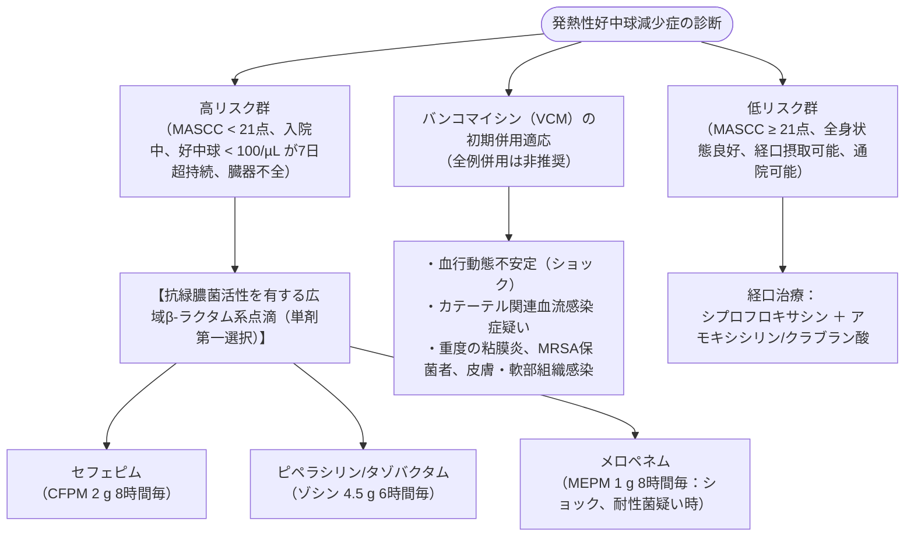

# 発熱性好中球減少症 (FN)
親カテゴリ: [[clinical-flows/J_感染症/index|J章 感染症]]

## 定義
抗癌化学療法や免疫抑制療法後に生じる超緊急病態[cite: 908]：
1. **好中球数 $<500\ /\mu\mathrm{L}$**（または現在 $<1,000\ /\mu\mathrm{L}$ で48時間以内に $<500$ に減少すると予測される）[cite: 908]
2. **発熱**: **口腔内温 $\ge38.3^\circ\mathrm{C}$（または腋窩 $\ge37.5〜38.0^\circ\mathrm{C}$）の一過性発熱**、または **$\ge38.0^\circ\mathrm{C}$ が1時間以上持続**[cite: 908]

---

## リスク層別化（MASCC スコア）

合計スコア **$\ge21$ 点を「低リスク群」**、**$<21$ 点を「高リスク群」** と判定[cite: 908, 910]：
- 症状の負担度（無症状/軽度 5点、中等度 3点）[cite: 910]
- 低血圧なし（収縮期 $>90\ \mathrm{mmHg}$）(5点)[cite: 910]
- 慢性閉塞性肺疾患 (COPD) なし (4点)[cite: 910]
- 固形癌、または真菌感染歴のない血液腫瘍 (4点)[cite: 910]
- 脱水なし (3点)[cite: 910]
- 発症時外来通院中 (3点)[cite: 910]
- 年齢 $<60$ 歳 (2点)[cite: 910]

---

## 初期治療プロトコル

好中球欠乏下では炎症所見（膿・局所発赤）が形成されず、急速に敗血症死に至る[cite: 908]。**診察・血液培養2セット採取後、60分以内に抗緑膿菌活性を有する抗菌薬を単剤静注**する[cite: 908, 910]：

---

## 治療不応性発熱のステップアップ

抗菌薬開始後 **3〜5日経過しても発熱が持続**する場合[cite: 909, 911]：

1. **熱源の徹底的再検索**:
   - 血液培養再検、胸部CT（侵襲性アスペルギルス症・真菌結節の探索）、カテーテル刺入部確認、**好中球減少性腸炎（盲腸炎：右下腹部痛・下痢・腸管壁肥厚）の除外**[cite: 909, 911, 913, 914]。
2. **抗真菌薬のエンピリック追加**:
   - カンジダ・アスペルギルスを標的として、**カスポファンギン（カンサイダス 初回70 mg → 50 mg/日）** または **ボリコナゾール**、**リポソーマル・アムホテリシンB（アムビゾーム）** を追加併用[cite: 911]。
