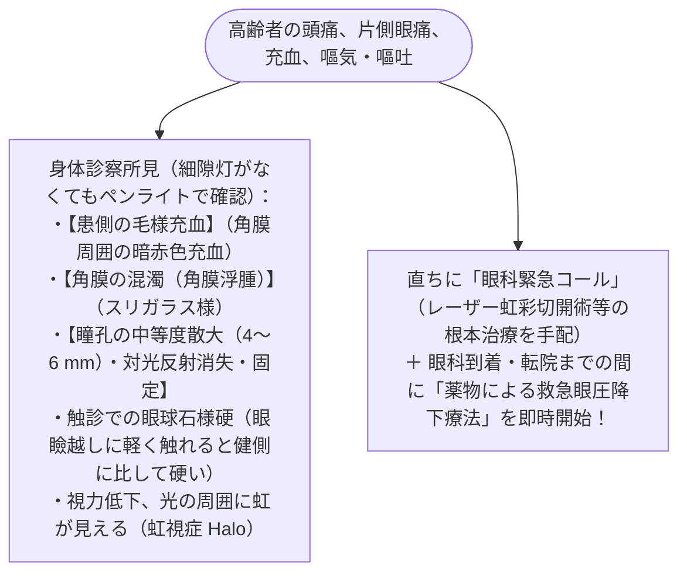

# 急性閉塞隅角緑内障発作の薬物治療
親カテゴリ: [[clinical-flows/K_マイナー疾患_他/index|K章 マイナー疾患、他]]

## 救急初期アセスメントとトリアージ

急激な隅角閉塞により房水流出路が遮断され、**眼圧が急上昇（通常 40〜70 mmHg、正常値 10〜21 mmHg）** する超緊急眼科疾患[cite: 921]。

> [!WARNING]- 片頭痛・急性腹症・くも膜下出血との誤診ピットフォール
> アジア人（解剖学的に前房が浅い）、高齢女性、遠視の患者に好発[cite: 921, 922]。激しい頭痛と嘔吐、腹痛のみが前面に出て眼痛を強く訴えない場合があり、**消化器疾患や頭蓋内病変と誤認されて散瞳作用のある鎮痙薬・抗コリン薬・抗うつ薬・アトロピンを投与されると完全閉塞して不可逆的失明**を招く[cite: 921, 922]。

---

## 救急眼圧降下薬物プロトコル

眼科医到着または搬送までの間に、**作用機序の異なる薬剤を直ちにフル動員（併用投与）** する[cite: 921, 922]：

### 1. 高浸透圧利尿薬（即効性・最強力：硝子体容積を急速縮小）
- **20%マンニトール（マンニットール）**: **1.0〜2.0 g/kg（250〜500 mL）を30〜60分で急速点滴静注**[cite: 921]。
- または **高浸透圧グリセリン（グリセオール）**: 300〜500 mL を45〜90分で点滴静注[cite: 921]。
- ※心不全、重度腎不全、高度脱水合併時は溢水・肺水腫・高血糖（グリセリン）に注意[cite: 921]。

### 2. コリン作動薬（縮瞳薬：虹彩根部を牽引して隅角を開放）
- **ピロカルピン塩酸塩点眼（サンピロ 1%または2%点眼液）**:
  - 発作眼に **15〜30分毎に1滴ずつ頻回点眼**（1時間で計2〜3回）[cite: 921, 922]。
  - ※眼圧が $>50〜60\ \mathrm{mmHg}$ の極度高値では瞳孔括約筋が虚血麻痺し反応しないため、マンニトール等で眼圧が低下した後に効果を発揮する[cite: 921]。

### 3. 房水産生抑制点眼薬・内服薬
- **β遮断薬点眼**: チモロール点眼液（チモプトール 0.5%）1滴点眼（喘息、高度徐脈、心不全には禁忌）[cite: 921, 922]。
- **$\alpha_2$受容体作動薬点眼**: ブリモニジン点眼液（アイファガン 0.1%）1滴点眼[cite: 921, 922]。
- **炭酸脱水酵素阻害薬**:
  - **アセタゾラミド（ダイアモックス 500 mg 静注）**、または 経口 250〜500 mg 内服[cite: 921, 922]。
- **局所ステロイド点眼**: ベタメタゾン点眼液（リンデロン等）を併用（前房内の二次的炎症を鎮静化）[cite: 922]。

---

## 根本治療（眼科的処置）

- **レーザー虹彩切開術 (LI) または 観血的周辺虹彩切除術**:
  - 薬物療法で眼圧を下げ角膜浮腫を消退させた後、直ちに施行して永続的な房水バイパスを作成する[cite: 921, 922]。
- **対側眼の予防**: 健側眼も同様に解剖学的狭隅角を有しているため、原則として**対側眼にも予防的レーザー虹彩切開術**を行う。
